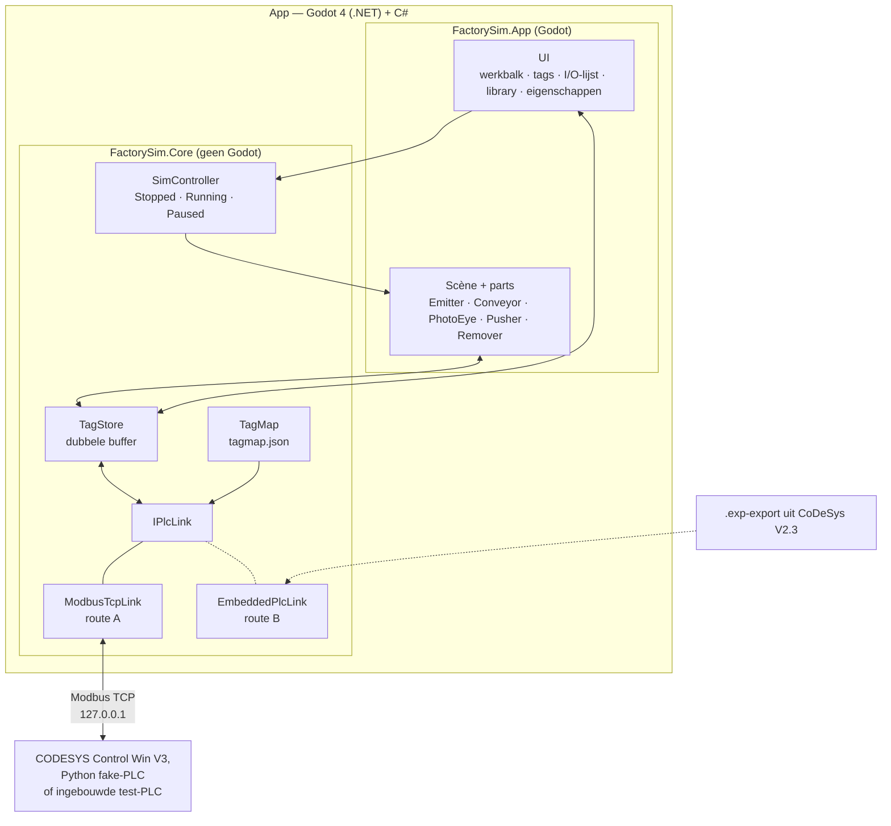
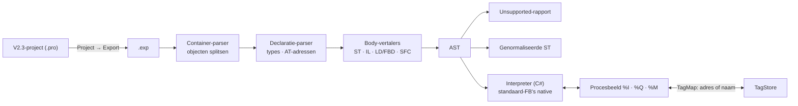
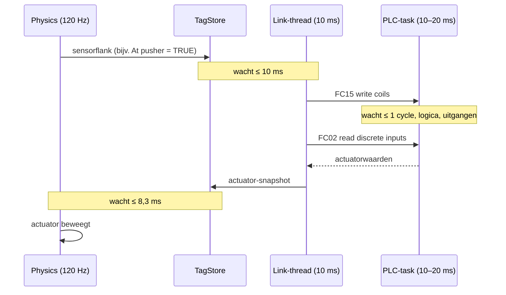
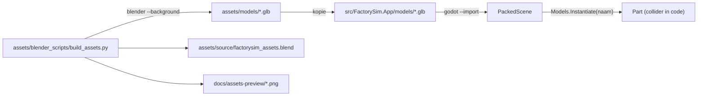
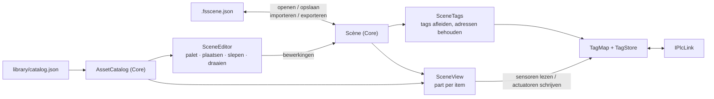
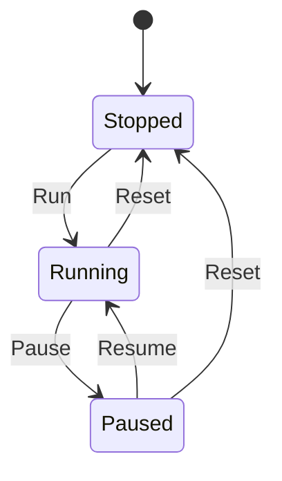

# ARCHITECTURE

Dit document beschrijft wat gebouwd wordt en is leidend voor de code.

## Overzicht

Eén simulatiekern, twee manieren om er een PLC aan te hangen. Beide routes implementeren dezelfde interface (`IPlcLink`), zodat scène, tags en UI niet weten welke PLC er draait.

## Componenten

| Component | Project | Verantwoordelijkheid |
|-----------|---------|----------------------|
| Parts (`Conveyor`, `Emitter`, `Remover`, `PhotoEye`, `Pusher`, `Box`) | App | Godot-nodes met physics. `Main` bindt ze op tagnaam (`TagNames`) aan de `TagStore`: sensoren schrijven tags, actuatoren lezen tags. Aparte `ISensor`/`IActuator`-interfaces volgen pas bij de scene editor |
| `SelfTest` | App | Onbeheerde run (`--selftest=…`) die de PLC speelt via tags en PASS/FAIL meldt |
| UI | App | `Shell` maakt de schermindeling (werkbalk, zijpanelen, onderpaneel, statusbalk); `Hud` vult de simulatieknoppen, de PLC-verbinding, de tag-tabel (live + force) en de I/O-lijst; `SceneEditor` vult de library en de eigenschappen |
| Editorlogica | Core | `IoList` (tags met hun onderdeel, filter, CSV), `SceneHistory` (undo/redo), `SceneOverlap`, `SceneSupports`, `ItemParams`, `AssetCatalog.Search` — alles met unit tests |
| `Tag`, `TagStore` | Core | Eén waarheid voor alle tagwaarden; thread-safe snapshots; force |
| `TagMap` | Core | Koppelt tags aan PLC-adressen/-variabelen; JSON in, CSV uit |
| `SimController` | Core | Simulatietoestand en reset; levert tag `Sim running` |
| `IPlcLink` | Core | `Connect()`, `Exchange(sensors) → actuators`, `Status`, statistiek |
| `ModbusTcpLink` | Core | Route A: Modbus TCP-client op een eigen thread |
| `EmbeddedPlcLink` | Core | Route B: ingebouwde V2.3-runtime (spoor B) |
| `TestApiServer`, `ApiRouter`, `MainThreadQueue` | Core | Lokale test-API (taak 21): HTTP op `127.0.0.1` via een eigen `TcpListener`-thread, token per start. De derde koppeling naast Modbus en (later) OPC UA, maar geen `IPlcLink`: hij bestuurt de app (`ISimControl`, geïmplementeerd door `Main`) in plaats van tags uit te wisselen. Tags lezen gaat rechtstreeks via `TagStore.Snapshot`; opdrachten die de scène raken via `MainThreadQueue`, die `Main._Process` elk frame leegt (time-out 5 s). Zie SECURITY.md |
| Fake-PLC | `tools/fake_plc` | Python Modbus-server met dezelfde I/O-indeling, voor integratietests |
| Ingebouwde test-PLC | `FactorySim.Core.Plc.TestPlc` | Dezelfde server in C# (plan 29), in de app gestart met de knop *Ingebouwde test-PLC*; eigen threads, alleen `127.0.0.1`, vrije poort |

Ontwerpregel: **alles wat zonder Godot kan, zit in Core** en is met `dotnet test` te testen. De Godot-laag bevat alleen wat physics, rendering of invoer nodig heeft.

## Tag-model

| Veld | Betekenis |
|------|-----------|
| `Name` | Unieke naam in de scène, bijv. `At pusher` |
| `Direction` | `Sensor` (app → PLC) of `Actuator` (PLC → app) |
| `Kind` | `Bool` (aan/uit, `BOOL`) of `Int` (16 bit met teken, `INT`; sinds taak 6) |
| `Value` / `Number` | Actuele waarde: een bit, of het getal op de lijn |
| `Scale`, `Unit`, `Min`, `Max` | Alleen `Int`: getal op de lijn = waarde in de simulatie × `Scale`; daarbuiten wordt afgeknepen op `Min`–`Max` en altijd op −32768–32767 |
| `Forced`, `ForcedValue` / `ForcedNumber` | Handmatige override; bij een sensor gaat de geforceerde waarde naar de PLC, bij een actuator overschrijft hij de PLC |

`TagMap`-regel per tag: tagnaam · Modbus-area + offset (route A) · IEC-adres of variabelenaam (route B) · CODESYS-variabelenaam (documentatie) · bij een `Int`-tag `kind`, `scale`, `unit`, `min`, `max`. Een regel zonder `kind` is `Bool`; zo laden oude scènes en `tagmap.json` ongewijzigd, en een scène zonder analoge tags wordt byte voor byte hetzelfde opgeslagen.

| Soort | Richting | Modbus-area | Function code | IEC-adres |
|-------|----------|-------------|---------------|-----------|
| `Bool` | Sensor (app → PLC) | Coil | FC15 | `%IX0.0` |
| `Bool` | Actuator (PLC → app) | Discrete input | FC02 | `%QX0.0` |
| `Int` | Sensor (app → PLC) | Holding register | FC16 | `%IW0` |
| `Int` | Actuator (PLC → app) | Input register | FC04 | `%QW0` |

Een register bevat het `INT` als two's complement (−1 is `0xFFFF`). Adressen worden per area toegekend: laagste vrije offset, bestaande adressen blijven staan; coil 0 en holding register 0 bestaan naast elkaar. Let op voor route B: `%IW0` en `%IX0.0` overlappen in IEC-zin (hetzelfde byte); dat speelt pas als spoor B een eigen procesbeeld krijgt.

**Eén store, twee soorten** (keuze bij taak 6). `TagStore` houdt naast de bool-arrays vier arrays met getallen bij (sensor werkend/gepubliceerd, actuator inbox/vastgeklikt), met dezelfde regels: publiceren bij `EndTick`, force en release. De bestaande aanroepen (`SensorNames`, `ActuatorNames`, `SnapshotSensors`, `ApplyActuators`) zien alleen de bool-tags, precies als vóór taak 6; elke zelftest en de koppeling blijven zo ongewijzigd. De getallen hebben eigen aanroepen: `AnalogSensorNames`, `SetSensorNumber`/`SetSensorValue`, `GetActuatorNumber`/`GetActuatorValue`, `SnapshotSensorNumbers`, `ApplyActuatorNumbers`, `Force(naam, int)`. Het alternatief, een tweede store voor getallen, zou elke plek die tags doorgeeft (scène, koppeling, UI, zelftest) twee stores laten meenemen en force/release en de tick op twee plaatsen laten synchroniseren; dat is afgewezen.

### Tags van de MVP-scène

| Tag | Richting | Modbus (route A) | IEC-adres (route B) | Variabele |
|-----|----------|------------------|---------------------|-----------|
| Start button | Sensor | Coil 0 | `%IX0.0` | `iStart` |
| Stop button | Sensor | Coil 1 | `%IX0.1` | `iStop` |
| At pusher | Sensor | Coil 2 | `%IX0.2` | `iAtPusher` |
| High box | Sensor | Coil 3 | `%IX0.3` | `iHighBox` |
| Pusher back | Sensor | Coil 4 | `%IX0.4` | `iPusherBack` |
| Pusher front | Sensor | Coil 5 | `%IX0.5` | `iPusherFront` |
| Sim running | Sensor | Coil 6 | `%IX0.6` | `iSimRunning` |
| Conveyor | Actuator | Discrete Input 0 | `%QX0.0` | `oConveyor` |
| Pusher | Actuator | Discrete Input 1 | `%QX0.1` | `oPusher` |
| Emitter | Actuator | Discrete Input 2 | `%QX0.2` | `oEmitter` |
| Run lamp | Actuator | Discrete Input 3 | `%QX0.3` | `oRunLamp` |

## Datastromen

Per physics tick (120 Hz, main thread), in `Main._PhysicsProcess`:
1. De sensorwaarden die de parts in de vorige tick hebben gemeten gaan naar `TagStore` (`SetSensor`), samen met de operator-knoppen en `Sim running`.
2. `TagStore.EndTick()` publiceert die sensorwaarden voor de PLC-link en klikt de laatste actuatorwaarden van de PLC vast.
3. De parts krijgen hun actuatorwaarden (`GetActuator`): band aan/uit, pusher, emitter.
4. Daarna draaien de parts en de physics-stap; de sensoren meten opnieuw.

Direct na stap 2 neemt `TagRecorder` (Core) de tick op met de simulatietijd, maar alleen als de simulatietijd verder is gegaan (Running of één *Stap*). De recorder bewaart alleen wijzigingen per tag (tijd, waarde als `int`, force), de laatste 10 minuten en hooguit een miljoen; wat wegvalt laat de stand op de grens achter (`Origin`). Lezen: `ValueAt`, `Changes`, `Edges`, `ToCsv`. Alles op de main thread. Het tabblad *Trace* (`TraceView`, `TraceCanvas`) tekent er alleen het zichtbare venster uit.

Na stap 3 krijgt `ProductionStats` (Core) dezelfde tick met de toename van de simulatietijd als `dt` en de stand van de actuator-tags; ook alleen als de simulatietijd verder ging, dus in pauze loopt de aan-tijd niet op. Emitters en removers melden hun items via events van `SceneView` (die overleven het opnieuw opbouwen van de scène); een item (`Box`) draagt zijn `SpawnTime`.

Sensoren lopen daardoor één tick (8,3 ms) achter op de physics. De PLC-link leest en schrijft alleen wat `EndTick` heeft vrijgegeven; de simulatie wacht nooit op de PLC en geen van beide kanten ziet een half geschreven tick.

**Analoge tags op de lijn**: de link neemt bits en getallen van dezelfde tick (`SnapshotSensorImage`), maar op de lijn zijn het twee aanvragen (FC15 en FC16), en terug ook (FC02 en FC04). Tussen die twee kan de PLC een scan draaien; binnen één area is de waarde wel altijd van één tick. De twee extra aanvragen gaan alleen over de lijn als de scène analoge tags heeft.

**Pauze**: alle bewegende en metende parts hangen onder de node `World` (pausable). Bij Stopped en Paused staat de scene tree op pauze, waardoor physics en parts stilstaan; `Main`, de UI en de camera blijven draaien, zodat tags, force en de PLC-link doorwerken.

**Zelftest**: `SelfTest` speelt de PLC via dezelfde aanroepen als een link (`SnapshotSensors` / `ApplyActuators`) en stuurt geen part rechtstreeks aan.

## Route A — CODESYS V3 via Modbus TCP

- CODESYS-kant: *Modbus TCP Slave Device* (server) in CODESYS Control Win V3. De app is de client.
- Per iteratie (10 ms, eigen thread): **FC15** schrijft alle sensor-tags naar coils; **FC02** leest alle actuator-tags uit discrete inputs.
- Coils zijn voor het PLC-programma ingangen; discrete inputs zijn uitgangen. Dit wordt in M4 tegen de echte runtime bevestigd.
- Unit ID 0 of 255 bij CODESYS SP16+.
- Time-out 200 ms, daarna status *Disconnected* en automatisch opnieuw verbinden; actuatoren houden hun laatste waarde tot Reset.
- De fake-PLC gebruikt dezelfde indeling op poort 5020.

## Route B — CoDeSys V2.3 direct

- Invoer is de tekstexport `.exp`; binaire projectbestanden worden niet gelezen.
- Eén interne boom (AST) voor alle talen; IL, LD/FBD en SFC worden ernaar vertaald.
- **Unsupported-rapport** bij elke import: taal, constructie, library of parserfout, met POU, pad en regel. Een project start alleen als alle vanuit de taak bereikbare POU's volledig ondersteund zijn.
- Scan in **lockstep** met physics; PLC-tijd is simulatietijd; run, pause en single-step.

## Timing: physics-step versus scan cycle

### Route A — drie asynchrone klokken

| Klok | Waarde | Waar |
|------|--------|------|
| Physics tick | 120 Hz (8,33 ms), vaste stap | Godot main thread |
| Link-poll | 10 ms | Eigen thread in Core |
| PLC task cycle | 10–20 ms | CODESYS (Windows, geen hard real-time) |

Berekende vertraging sensorflank → actuator: ~2–5 ms in het beste geval, ~50 ms in het slechtste (task 20 ms), gemiddeld ~20–25 ms.

**Gemeten in M3** (2026-11-15, localhost, fake-PLC met scan 10 ms, poll 10 ms): Modbus round-trip gemiddeld 0,05 ms (p99 0,34 ms); sensorflank → actuator gemiddeld 22 ms, p99 32 ms, maximum 33 ms over 200 flanken. Die meting loopt van de tag store tot de tag store; in de app komt daar tot één physics tick (8,3 ms) aan elke kant bij. De waarden tegen CODESYS Control Win volgen in M4. Bij 0,6 m/s is 50 ms ongeveer 30 mm bandweg, dus de scène krijgt ≥ 50 mm marge rond sensoren en pusher.

Gevolgen en maatregelen:
- **Pauze**: de PLC loopt door. De tag `Sim running` gaat naar de PLC zodat het programma timers en sequenties kan vasthouden.
- **Tijdschaal** (sinds taak 9): `SimController` heeft een simulatieklok (`SimTime`, de som van de ticks die de wereld echt liep) en een schaal ×0,25–×4. `Main` zet `Engine.TimeScale` en schaalt `Engine.PhysicsTicksPerSecond` mee (120 × schaal), zodat elke stap 1/120 s simulatietijd blijft; `Engine.TimeScale` alleen houdt het aantal ticks per seconde gelijk en maakt de stap groter (gemeten, zie `TROUBLESHOOTING.md`). Boven ×1 mag Godot ook meer stappen per frame doen (8 × schaal). Een stap in pauze haalt de scene tree één physics-frame uit pauze. In route A pollt de koppeling op echte tijd door; bij een andere schaal kloppen de timers van een externe PLC dus niet, en de statusbalk waarschuwt.
- **Korte pulsen**: een doos van 0,3 m bij 0,6 m/s geeft een puls van 500 ms — ruim boven poll + cycle.
- **Consistent I/O-beeld**: alle coils in één FC15-request; buffers wisselen atomisch.

### Route B — één klok

Scan en physics lopen in lockstep: sensor-tags → `%I` → taak uitvoeren → `%Q` → actuator-tags → physics-stap. Het scan-interval is een geheel aantal physics ticks. Timers rekenen met simulatietijd, dus pauze, single-step en time scale zijn exact en twee runs met dezelfde seed geven dezelfde trace.

## Asset-pijplijn

De looks staan los van het gedrag. Elk part heeft een primitive collider in code en hangt daar een model onder; het model heeft geen colliders en geen invloed op de physics.

- `Parts/Models.cs` laadt `res://models/<naam>.glb`, zoekt bewegende delen op naam (`Models.Part`) en geeft een mesh een eigen materiaal (`Models.OwnMaterial`) zodat het per exemplaar kan veranderen.
- Wat de code met de modellen doet:

| Part | Model | Gestuurd door |
|------|-------|---------------|
| `Conveyor` | `Belt`: UV schuift met `Speed / 0,25` per seconde · `Roller_Head`/`Roller_Tail`: draaien met `Speed / 0,06` rad/s | `Running` (tag `Conveyor`) |
| `Pusher` | `PusherPlate` en `PusherRod` bewegen met de body; `PusherBody` staat los van de beweging (`TopLevel`) | tag `Pusher` |
| `PhotoEye` | `SensorLed` licht op, `SensorBeam` wordt feller; de straal wordt naar het bereik geschaald | `Detecting` (tags `At pusher`, `High box`) |
| `Emitter` | `EmitterLamp` groen | `Enabled` (tag `Emitter`) |
| Rails | `guide_rail_1m` in de lengte geschaald + `rail_bracket` om de ~0,9 m | — |

Conventies, stijlgids en "een asset toevoegen": [ASSETS.md](ASSETS.md).

## Scènes en editor

De scène staat niet in de code maar in een scènebestand. Details: [SCENES.md](SCENES.md).

- `SceneView` maakt voor elk item het part dat bij het gedrag van het asset hoort (conveyor, bocht, stop, pusher, photo-eye, emitter, remover, rail, knop, lamp, wielsorteerder/kettingovername, zwenkarm, draaitafel, pick & place, lift, palletiseerder, bewerkingscentrum, magazijnkraan, stelling) en legt vast welke tag uit welk part leest of ernaar schrijft. Assets zonder gedrag worden als decoratie geplaatst, zonder collider.
- `Main` wisselt per physics tick alle tags van de scène uit met de `TagStore`; het weet niet welke onderdelen er staan.
- Bij elke wijziging in de editor wordt de scène opnieuw opgebouwd en worden de tags opnieuw afgeleid; opgeslagen adressen blijven behouden.
- De editor werkt alleen met de simulatie gestopt.

## Toestanden

Reset: dozen verwijderen, actuatoren naar rust, sensoren FALSE, tellers op nul.
