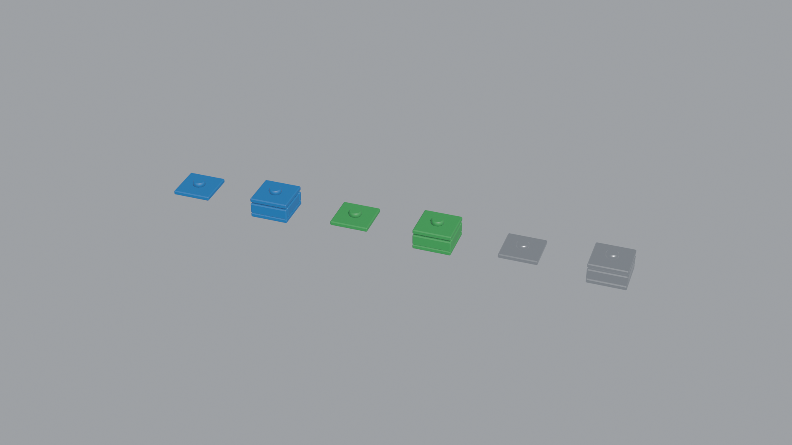
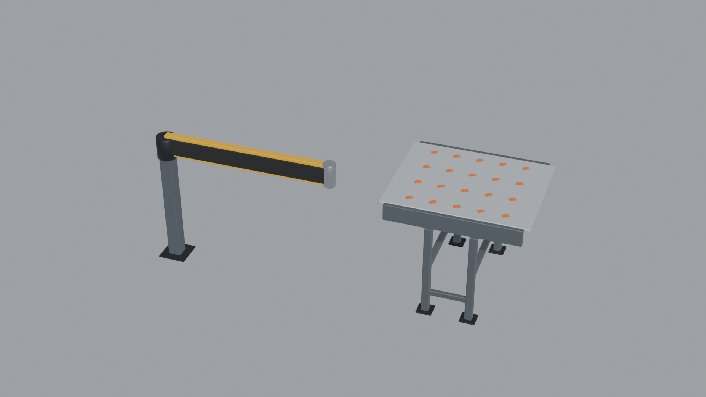
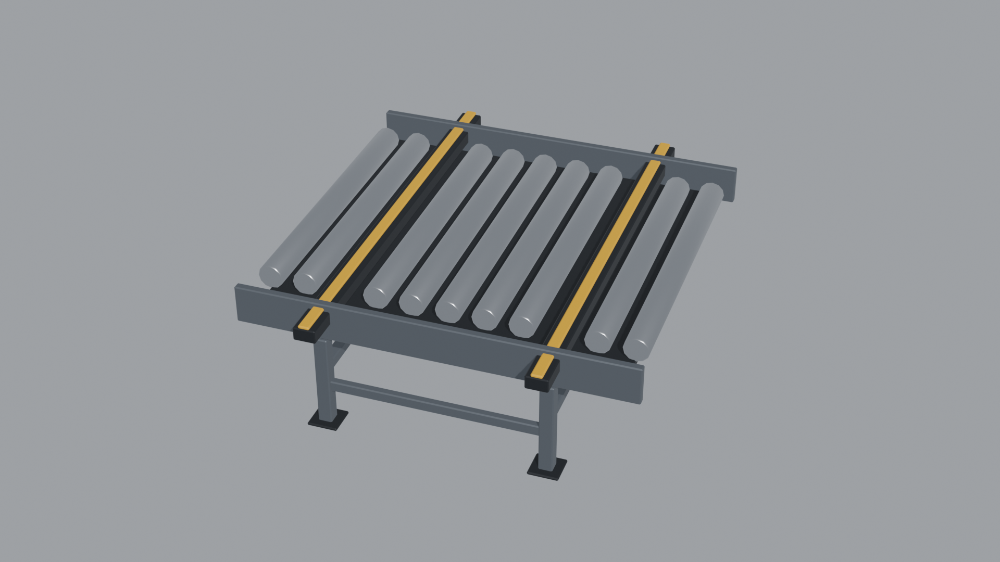
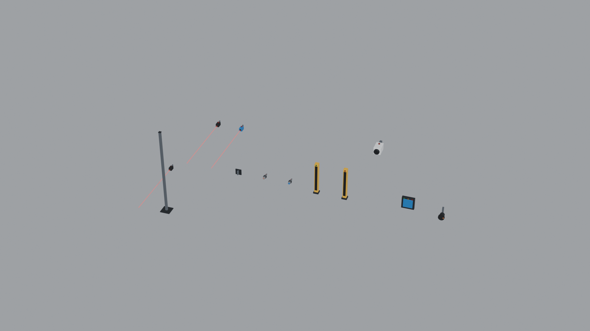
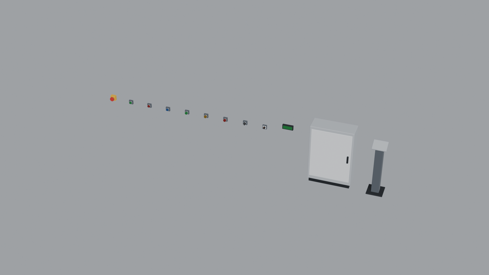
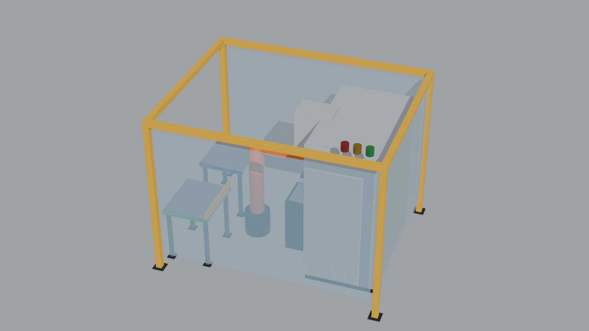
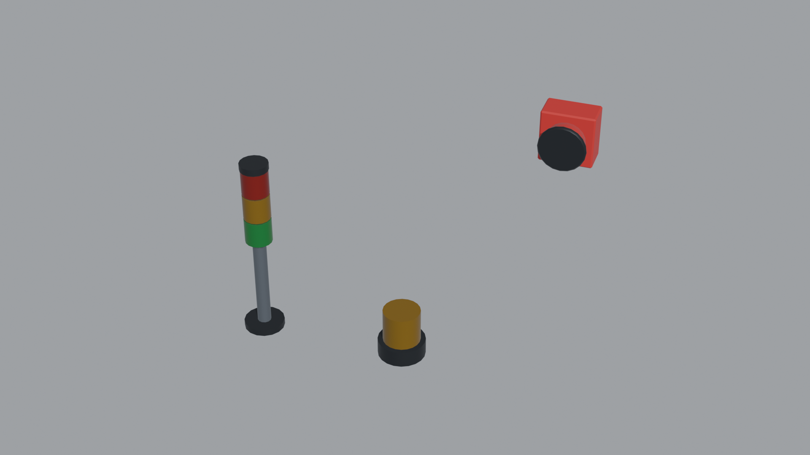
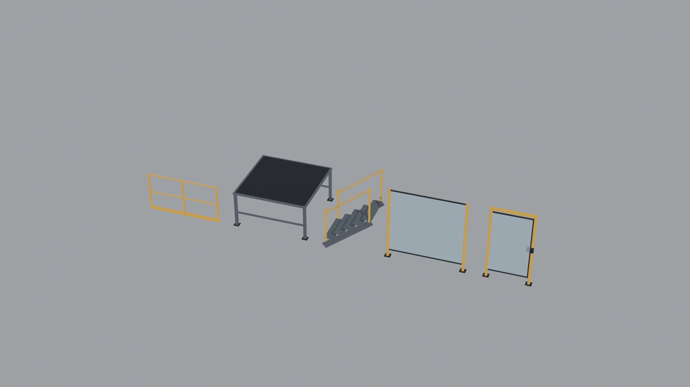
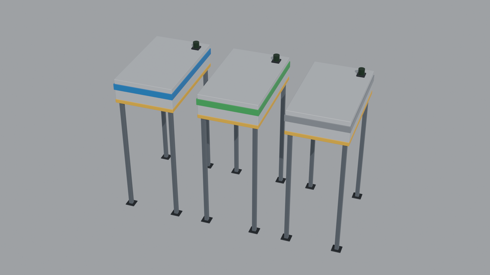

# LIBRARY — inhoud van de asset library

_Gegenereerd uit `assets/library/catalog.json`. Niet met de hand bewerken: pas de generator aan en bouw opnieuw (zie [ASSETS.md](ASSETS.md))._

**102 assets**: 76 werken in de simulatie, 1 is alleen visueel, 20 zijn items, 5 zijn interne hulponderdelen.

Alle modellen zijn eigen ontwerpen uit eigen code.

## Items

| Asset-id | Naam | In de simulatie | Maat (l × b × h, m) | Driehoeken |
|---|---|---|---|---:|
| `box_low` | Doos laag (MVP) | Item (door emitter gespawnd) | 0,3 × 0,3 × 0,2 | 176 |
| `box_high` | Doos hoog (MVP) | Item (door emitter gespawnd) | 0,3 × 0,3 × 0,35 | 176 |
| `box_small` | Doos klein | Item (door emitter gespawnd) | 0,3 × 0,3 × 0,2 | 176 |
| `box_medium` | Doos middel | Item (door emitter gespawnd) | 0,4 × 0,4 × 0,3 | 176 |
| `box_large` | Doos groot | Item (door emitter gespawnd) | 0,5 × 0,5 × 0,4 | 176 |
| `pallet` | Pallet | Item (door emitter gespawnd) | 1,2 × 0,8 × 0,14 | 748 |
| `pallet_square` | Pallet vierkant | Item (door emitter gespawnd) | 1 × 1 × 0,14 | 748 |
| `stackable_box` | Stapelbak | Item (door emitter gespawnd) | 0,62 × 0,42 × 0,3 | 308 |
| `raw_material_blue` | Grondstof blauw | Item (door emitter gespawnd) | 0,25 × 0,25 × 0,15 | 44 |
| `product_base_blue` | Productbasis blauw | Item (door emitter gespawnd) | 0,25 × 0,25 × 0,1 | 220 |
| `product_lid_blue` | Productdeksel blauw | Item (door emitter gespawnd) | 0,25 × 0,25 × 0,06 | 168 |
| `final_product_blue` | Eindproduct blauw | Item (door emitter gespawnd) | 0,25 × 0,25 × 0,17 | 388 |
| `raw_material_green` | Grondstof groen | Item (door emitter gespawnd) | 0,25 × 0,25 × 0,15 | 44 |
| `product_base_green` | Productbasis groen | Item (door emitter gespawnd) | 0,25 × 0,25 × 0,1 | 220 |
| `product_lid_green` | Productdeksel groen | Item (door emitter gespawnd) | 0,25 × 0,25 × 0,06 | 168 |
| `final_product_green` | Eindproduct groen | Item (door emitter gespawnd) | 0,25 × 0,25 × 0,17 | 388 |
| `raw_material_metal` | Grondstof metaal | Item (door emitter gespawnd) | 0,25 × 0,25 × 0,15 | 44 |
| `product_base_metal` | Productbasis metaal | Item (door emitter gespawnd) | 0,25 × 0,25 × 0,1 | 220 |
| `product_lid_metal` | Productdeksel metaal | Item (door emitter gespawnd) | 0,25 × 0,25 × 0,06 | 168 |
| `final_product_metal` | Eindproduct metaal | Item (door emitter gespawnd) | 0,25 × 0,25 × 0,17 | 388 |

## Light load

| Asset-id | Naam | In de simulatie | Maat (l × b × h, m) | Driehoeken |
|---|---|---|---|---:|
| `conveyor_straight_6m` | Bandtransporteur 6 m (MVP) | Conveyor (tag: aan/uit) | 6 × 1,05 × 0,82 | 1852 |
| `conveyor_straight_1m6_wide` | Brede band 1,6 m (MVP) | Conveyor (tag: aan/uit) | 1,6 × 1,45 × 0,81 | 1412 |
| `pusher` | Pusher | Pusher (tag + 2 eindstanden) | 0,6 × 1,16 × 1,07 | 1008 |
| `belt_conveyor_2m` | Bandtransporteur 2 m | Conveyor (tag: aan/uit) | 2 × 1,05 × 0,82 | 1412 |
| `belt_conveyor_4m` | Bandtransporteur 4 m | Conveyor (tag: aan/uit) | 4 × 1,05 × 0,82 | 1632 |
| `belt_conveyor_6m` | Bandtransporteur 6 m | Conveyor (tag: aan/uit) | 6 × 1,05 × 0,82 | 1852 |
| `belt_conveyor_curved` | Bochtband 90° | Bocht (tag: aan/uit) | 1,46 × 1,46 × 0,8 | 432 |
| `belt_conveyor_inclined` | Hellende band | Conveyor (tag: aan/uit; helling 14°, omhoog of omlaag) | 4,01 × 1,05 × 1,81 | 1632 |
| `belt_conveyor_gate` | Bandtransporteur met doorgang | Conveyor (tag: aan/uit) | 2,07 × 1,05 × 1,25 | 1536 |
| `conveyor_scale` | Weegband | Conveyor (tag: aan/uit; gewicht als analoge tag) | 1 × 0,93 × 1,33 | 772 |
| `spur_conveyor` | Aftakband | Conveyor (tag: aan/uit) | 2,1 × 1,08 × 0,82 | 1412 |
| `pivot_arm_sorter` | Zwenkarm-sorteerder | Zwenkarm (tag: arm over de band) | 1,32 × 0,2 × 1,0 | 456 |
| `popup_wheel_sorter` | Wielsorteerder | Wielsorteerder (tags: rechtdoor, left, right) | 1 × 0,94 × 0,81 | 2156 |
| `aligner` | Uitlijner | Passief (twee geleiders die naar het midden duwen) | 1,21 × 1,1 × 0,25 | 220 |
| `chute` | Glijgoot | Passief (glijvlak met zijwanden) | 1,53 × 0,9 × 0,88 | 484 |
| `stop_blade` | Stopblad | Stop (tag: omhoog/omlaag) | 0,12 × 0,92 × 0,2 | 196 |
| `metal_corner` | Hoekaanslag | Passief (vaste hoekaanslag) | 0,51 × 0,51 × 0,2 | 132 |
| `positioning_bars` | Positioneerbalken | Positioneerbalken (tag: sluiten; eindstanden open en closed) | 0,5 × 1,63 × 1,39 | 396 |

## Heavy load

| Asset-id | Naam | In de simulatie | Maat (l × b × h, m) | Driehoeken |
|---|---|---|---|---:|
| `roller_conveyor_2m` | Rollenbaan 2 m | Conveyor (tag: aan/uit) | 1,95 × 1,55 × 0,52 | 1820 |
| `roller_conveyor_4m` | Rollenbaan 4 m | Conveyor (tag: aan/uit) | 3,95 × 1,55 × 0,52 | 3064 |
| `roller_conveyor_6m` | Rollenbaan 6 m | Conveyor (tag: aan/uit) | 5,95 × 1,55 × 0,52 | 4308 |
| `roller_conveyor_curved` | Rollenbocht 90° | Bocht (tag: aan/uit) | 2,21 × 2,21 × 0,5 | 432 |
| `loading_conveyor` | Laadbaan | Conveyor (tag: aan/uit) | 1,96 × 1,55 × 0,68 | 1864 |
| `roller_stop` | Rollenstop | Stop (tag: omhoog/omlaag) | 0,14 × 1,4 × 0,23 | 304 |
| `free_roller` | Vrijlopende rollenbaan | Passief (rollen zonder aandrijving) | 0,92 × 1,44 × 0,5 | 1064 |
| `chain_transfer` | Kettingovername | Kettingovername (tags: rechtdoor, left, right) | 1,42 × 1,6 × 0,5 | 836 |
| `turntable` | Draaitafel | Draaitafel (tags: rollen, reverse, turn; sensoren at 0, at 90) | 1,9 × 1,9 × 0,5 | 1040 |
| `chute_low` | Lage glijgoot | Passief (glijvlak met zijwanden) | 1,52 × 1,4 × 0,59 | 484 |

## Sensors

| Asset-id | Naam | In de simulatie | Maat (l × b × h, m) | Driehoeken |
|---|---|---|---|---:|
| `photo_eye` | Photo-eye (MVP) | Intern hulponderdeel | 0,05 × 1,1 × 0,07 | 312 |
| `sensor_post` | Sensorpaal | Intern hulponderdeel | 0,14 × 0,14 × 1,26 | 132 |
| `diffuse_sensor` | Diffuse sensor (photo-eye) | Photo-eye (sensortag) | 0,05 × 1,1 × 0,06 | 236 |
| `retroreflective_sensor` | Reflectiesensor | Reflectiesensor (1 sensor-tag; heeft een reflector nodig) | 0,05 × 1,1 × 0,06 | 236 |
| `reflector` | Reflector | Reflector (doel van een reflectiesensor; geen tags) | 0,08 × 0,05 × 0,08 | 132 |
| `capacitive_sensor` | Capacitieve sensor | Sensor (1 tag; elk item, bereik 0,2 m) | 0,04 × 0,11 × 0,05 | 200 |
| `inductive_sensor` | Inductieve sensor | Sensor (1 tag; alleen metaal, bereik 0,1 m) | 0,04 × 0,11 × 0,05 | 200 |
| `light_array_emitter` | Lichtscherm zender | Zender van een lichtscherm (geen tags) | 0,07 × 0,07 × 0,44 | 144 |
| `light_array_receiver` | Lichtscherm ontvanger | Lichtscherm (1 tag; 8 stralen; heeft een zender nodig) | 0,07 × 0,07 × 0,44 | 144 |
| `vision_sensor` | Vision-sensor | Vision (analoog: soort item; bit: gezien) | 0,09 × 0,21 × 0,1 | 412 |
| `rfid_reader` | RFID-lezer | Alleen visueel | 0,16 × 0,07 × 0,16 | 168 |
| `incremental_encoder` | Incrementele encoder | Encoder (2 sensor-tags: A en B) | 0,08 × 0,09 × 0,14 | 168 |

## Operators

| Asset-id | Naam | In de simulatie | Maat (l × b × h, m) | Driehoeken |
|---|---|---|---|---:|
| `emergency_stop` | Noodstop | Knop (sensor-tag; vergrendelend, NC-contact) | 0,1 × 0,1 × 0,1 | 244 |
| `push_button_green` | Drukknop groen (start) | Knop (sensor-tag; aan zolang ingedrukt) | 0,08 × 0,05 × 0,08 | 276 |
| `push_button_red` | Drukknop rood (stop) | Knop (sensor-tag; aan zolang ingedrukt) | 0,08 × 0,05 × 0,08 | 276 |
| `push_button_blue` | Drukknop blauw (reset) | Knop (sensor-tag; aan zolang ingedrukt) | 0,08 × 0,05 × 0,08 | 276 |
| `light_indicator_green` | Signaallamp groen | Lamp (actuator-tag) | 0,08 × 0,07 × 0,08 | 276 |
| `light_indicator_yellow` | Signaallamp geel | Lamp (actuator-tag) | 0,08 × 0,07 × 0,08 | 276 |
| `light_indicator_red` | Signaallamp rood | Lamp (actuator-tag) | 0,08 × 0,07 × 0,08 | 276 |
| `selector` | Keuzeschakelaar | Knop (sensor-tag; schakelt om per klik) | 0,08 × 0,08 × 0,08 | 412 |
| `potentiometer` | Potentiometer | Potentiometer (analoog naar de PLC, 0–1000) | 0,08 × 0,06 × 0,08 | 160 |
| `digital_display` | Digitaal display | Display (analoog van de PLC) | 0,2 × 0,04 × 0,09 | 56 |
| `electric_switchboard` | Schakelkast | Decor (één botsvorm over de hele kast) | 0,8 × 0,34 × 1,2 | 176 |
| `column` | Bedieningszuil | Decor (één botsvorm over de hele zuil) | 0,3 × 0,3 × 1,06 | 132 |

## Stations

| Asset-id | Naam | In de simulatie | Maat (l × b × h, m) | Driehoeken |
|---|---|---|---|---:|
| `robot_6axis` | Robotarm 6 assen | Robotarm (tags: pos 1/2/4/8, go, grip; sensoren busy, at pos, item, error) | 0,5 × 0,34 × 1,42 | 3148 |
| `machining_center` | Bewerkingscentrum | Bewerkingscentrum (tags: start, lid; sensoren: busy, entry, exit) | 3,16 × 2,56 × 2,43 | 2656 |
| `elevator` | Lift | Lift (tags: rollen, reverse, up; sensoren at bottom, at top) | 2 × 1,9 × 4,33 | 1156 |
| `pick_and_place` | Pick & place (3 assen) | Pick & place (tags: X, Y, Z, grab; sensoren moving X/Y/Z, item) | 2,76 × 1,96 × 2,3 | 1096 |
| `two_axis_pick_and_place` | Pick & place (2 assen) | Pick & place (tags: X, Z, grab; sensoren moving X/Z, item) | 2,36 × 1,06 × 2,2 | 1096 |
| `stacker_crane` | Magazijnkraan | Magazijnkraan (tags: vorken, lift, doelvak en go, of jog; sensoren: eindstanden, load, busy, at target) | 6 × 1,7 × 5,52 | 484 |
| `rack` | Magazijnstelling | Stelling (geen tags; draagbalken voor pallets) | 4,68 × 1,48 × 5 | 2112 |
| `palletizer` | Palletiseerder | Palletiseerder (tags: feed, push, open, up, down, rollers; 8 sensoren) | 2,8 × 2,6 × 3,3 | 2128 |
| `tank` | Tank | Tank (kleppen van de PLC, niveau en debiet naar de PLC, analoog) | 4 × 2,06 × 3,44 | 616 |

## Warning devices

| Asset-id | Naam | In de simulatie | Maat (l × b × h, m) | Driehoeken |
|---|---|---|---|---:|
| `stack_light` | Signaalzuil | Lamp (drie actuator-tags: green, yellow, red) | 0,12 × 0,12 × 0,56 | 344 |
| `warning_light` | Waarschuwingslamp | Lamp (actuator-tag) | 0,14 × 0,14 × 0,15 | 152 |
| `alarm_siren` | Sirene | Sirene (tag: aan/uit) | 0,14 × 0,13 × 0,14 | 356 |

## Walkways

| Asset-id | Naam | In de simulatie | Maat (l × b × h, m) | Driehoeken |
|---|---|---|---|---:|
| `handrail_2m` | Leuning 2 m | Decor (botsvormen: regels en staanders) | 2 × 0,04 × 1,1 | 120 |
| `platform_2x2` | Bordes 2 × 2 m | Decor (botsvormen: dek op 1,0 m en vier poten) | 2,05 × 2,05 × 1 | 528 |
| `stairs` | Trap | Decor (botsvormen: schuine plaat en zijwangen) | 1,35 × 0,97 × 2,08 | 204 |
| `safeguard_2m` | Veiligheidshek 2 m | Decor (één botsvorm over het hek) | 2,1 × 0,16 × 2 | 308 |
| `safety_door` | Veiligheidsdeur | Deur (aanklikken; 1 sensor-tag, TRUE zolang dicht) | 1,22 × 0,17 × 2,03 | 484 |
| `floor_text` | Vloertekst | Bordje (eigen tekst plat op de vloer; geen tags, geen botsvorm) | 1 × 0,3 × 0,002 | 48 |
| `sign_post` | Bordje | Bordje (eigen tekst aan beide kanten van de plaat; geen tags; botsvormen: paal en plaat) | 0,6 × 0,24 × 1,2 | 220 |

## Simulation

| Asset-id | Naam | In de simulatie | Maat (l × b × h, m) | Driehoeken |
|---|---|---|---|---:|
| `guide_rail_1m` | Geleiderail | Geleiderail (collider) | 1 × 0,02 × 0,08 | 56 |
| `rail_bracket` | Railbeugel | Intern hulponderdeel | 0,06 × 0,04 × 0,21 | 132 |
| `emitter_gantry` | Emitter | Emitter (tag: aan/uit) | 0,76 × 1,24 × 1,97 | 588 |
| `emitter_pallet` | Emitter (pallets) | Emitter voor pallets (tag: aan/uit) | 1,63 × 1,73 × 1,79 | 588 |
| `emitter_raw_blue` | Emitter (grondstof blauw) | Emitter voor grondstof (tag: aan/uit) | 0,76 × 1,24 × 1,97 | 632 |
| `emitter_raw_green` | Emitter (grondstof groen) | Emitter voor grondstof (tag: aan/uit) | 0,76 × 1,24 × 1,97 | 632 |
| `emitter_raw_metal` | Emitter (grondstof metaal) | Emitter voor grondstof (tag: aan/uit) | 0,76 × 1,24 × 1,97 | 632 |
| `remover_hood_1m0` | Remover (band 0,8 m) | Remover | 1,04 × 1,07 × 1,38 | 748 |
| `remover_hood_1m4` | Remover (band 1,2 m) | Remover | 1,04 × 1,47 × 1,38 | 924 |
| `floor_14x10` | Vloer 14 × 10 m | Intern hulponderdeel | 14 × 10 × 0,1 | 60 |
| `support_beam` | Steunbalk | Intern hulponderdeel | 0,06 × 0,06 × 1 | 12 |
