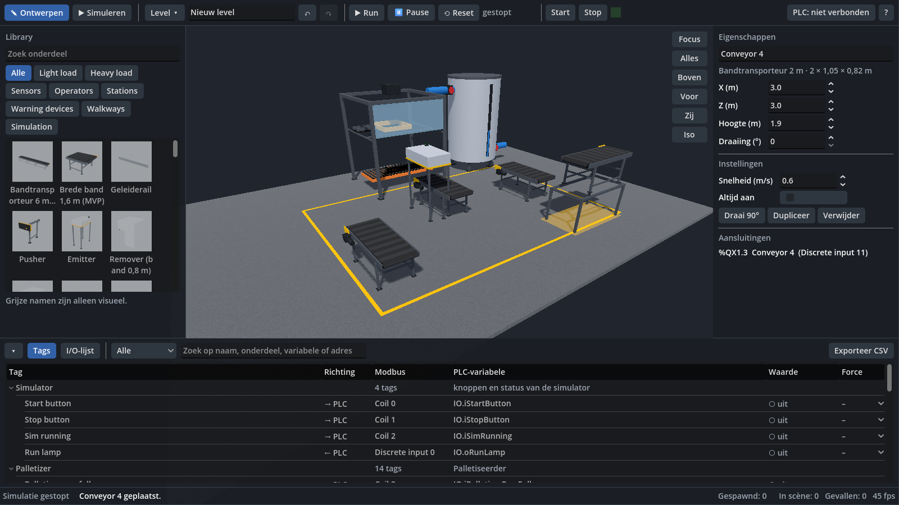
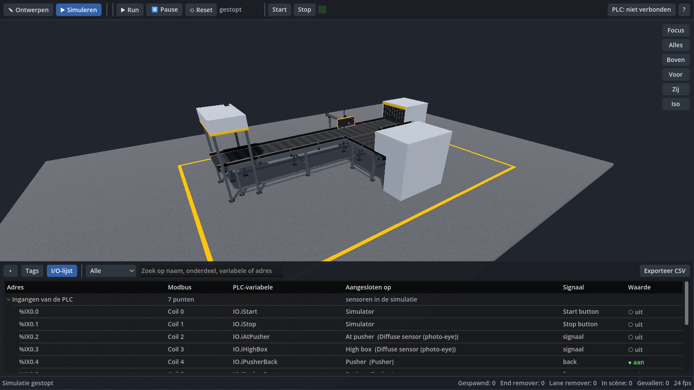

# SCENES — scènes ontwerpen, opslaan, exporteren en importeren

Een **scène** (project) is een opstelling van onderdelen uit de asset library plus de tag-mapping naar de PLC. De scène staat niet meer vast in de code: de app bouwt hem op uit een scènebestand. De MVP-sorteerlijn is zelf zo'n scène (`src/FactorySim.App/scenes/mvp_sorting.fsscene.json`).

_Bijgewerkt: 2026-11-23_

## Van level naar scène (plan 22)

Tot 2026-11-23 heette een scène een *level*. Wat er van toen nog is, blijft werken:

- **Oude bestanden** (`*.fslevel.json`, formaat `factorysim-level`) gaan open met *Openen…*, *Importeren…*, de galerij en `--scene=`. *Opslaan* schrijft altijd `.fsscene.json` met formaat `factorysim-scene`; een oud bestand dat je opent en opslaat komt naast het oude te staan met de nieuwe extensie.
- **De eigen map**: bij de eerste start na de update kopieert de app de bestanden uit `user://levels/` naar `user://scenes/` met de nieuwe extensie. De oude map blijft staan; de kopie gebeurt één keer (daarna staat `.migrated-from-levels` in de nieuwe map), en een bestand dat al bestaat wordt niet overschreven. Zelftests doen dit niet.
- **Instellingen**: een pad `res://levels/…` of `user://levels/…` in `settings.cfg` (laatste scène, camera, *Recent*) wordt bij het lezen `…/scenes/….fsscene.json`; de sleutels heten nu `scene` en `camera.scene` (de oude `level` en `camera.level` worden nog gelezen). Een geëxporteerd bestand elders houdt zijn pad.
- **Automatisch opslaan**: kopieën heten nu `….fsscene.json`; een kopie van vóór de update wordt nog gevonden.
- **Weg sinds plan 33** (2026-11-24): `--level=`, `POST /api/level/open`, het veld `level` in `/api/state` en `run_test.py --level`. Gebruik `--scene=`, `/api/scene/open`, `scene` en `--scene`; de oude namen geven nu 404 (API) of worden genegeerd (commandoregel).
- Blijft *level*: de tag `<naam> level` van de tank (een PLC-programma kan hem gebruiken) en `<naam> at level N` van de magazijnkraan; daar betekent het een hoogte.

## Het scherm



| Deel | Waar | Wat |
|------|------|-----|
| Werkbalk | boven | Wisselen tussen **Ontwerpen** en **Simuleren**; scènemenu, naam, ongedaan maken en opnieuw (alleen bij ontwerpen); Run, Pause, Reset, de tijdschaal (`«` `×1` `»`), **Stap**, Start, Stop, de lamp *in bedrijf* en *Geluid uit* (alleen bij simuleren, sinds plan 35); PLC-verbinding; **Help ▾** met *Aan de slag*, *Sneltoetsen en muis* en *Over FactorySim*. Past vanaf een venster van 1280 px |
| Library | links (ontwerpen) | Onderdelen met een plaatje. Zoekveld en knoppen per categorie. Een grijze naam is alleen visueel |
| Eigenschappen | rechts (ontwerpen) | Naam, positie, hoogte, draaiing en instellingen van het geselecteerde onderdeel; daaronder de aansluitingen (adres en tag) |
| Tags / I/O-lijst / Trace / Cijfers | onder | Vier tabbladen, zie hieronder. Het pijltje links klapt het paneel in |
| Statusbalk | helemaal onder | Simulatiestatus, simulatietijd (`t = 125,3 s`), de tijdschaal in oranje als die niet ×1 is, laatste melding, waarschuwing bij overlap, tellers en fps |
| Beeldknoppen | rechtsboven in het 3D-beeld | Focus op de selectie, hele scène, aanzicht van boven, voor, opzij en schuin |

Het 3D-beeld vult het venster; de camera richt zich op het midden van het vrije deel, niet op het midden van het venster. In de simulatiemodus zijn de library en de eigenschappen weg.

**Wat de app onthoudt** (sinds taak 15). De app begint waar je gebleven was. In `%APPDATA%\Godot\app_userdata\FactorySim\settings.cfg` staan:

| Onthouden | Niet onthouden |
|-----------|----------------|
| De laatst geopende of opgeslagen scène (pad) | Vanzelf verbinden met de PLC: verbinden blijft een klik |
| Host, poort en unit-ID in het PLC-venster | De tijdschaal: begint altijd op ×1 |
| Camera: doel, afstand en hoeken, alleen voor de scène waarbij hij is opgeslagen | Forces in de tag-tabel |
| Onderpaneel: ingeklapt of niet, en het laatste tabblad | De simulatietoestand: de app start altijd gestopt |
| Venster: grootte, plek en gemaximaliseerd (alleen op een scherm dat er nog is) | De hoogte van het onderpaneel: die staat vast |
| De laatste 10 geopende of opgeslagen scènes (voor een latere lijst *Recent*) | |

Bij het starten gaat `--scene=` voor; anders opent de app de scène van de vorige keer, en als dat niet lukt het standaardscène met een melding in de statusbalk. De app schrijft het bestand kort na een wijziging (als de stand een seconde gelijk blijft) en bij het sluiten van het venster. Een kapotte waarde valt terug op de standaard; de rest blijft gelden. Terug naar de standaard: sluit de app en verwijder `settings.cfg`. Zelftests lezen en schrijven het bestand niet.

### Tags

De tag-tabel is gegroepeerd per onderdeel; een groep klap je in met het pijltje. De groep *Simulator* bevat de vaste tags (Start, Stop, Sim running, Run lamp) en, als ze aan staan, de simulatie-tags `Sim paused` en `Sim reset`. Per tag: richting, Modbus-adres, PLC-variabele, live waarde en **Force** (`–` = vrij, `0` of `1` = vastzetten). Een geforceerde waarde is oranje.

Het filter toont alle tags, alleen sensoren, alleen actuatoren of alleen geforceerde tags. Het zoekveld zoekt op tagnaam, onderdeel, PLC-variabele en adres. Een klik op een rij selecteert het onderdeel en zet het in beeld; in de simulatiemodus licht het onderdeel daarbij een paar seconden op (een cyaan, doorzichtige doos).

**Tag aanwijzen, de andere kant op**: klik tijdens het simuleren op een onderdeel in het 3D-beeld, dan tonen de tag-tabel en de I/O-lijst alleen de tags van dat onderdeel (er verschijnt een knop *Alleen: naam ✕* naast het filter) en het onderdeel licht op. Een klik op lege vloer, of op die knop, toont weer alle tags. Een klik op een knop, schakelaar, noodstop of de veiligheidsdeur werkt gewoon als bediening en filtert niet. Het onderdeel wordt zoals in de ontwerpmodus via de vloer gevonden: een onderdeel dat hoog hangt klik je het best op de plek waar het op de vloer staat.

### I/O-lijst



De I/O-lijst laat zien waar elke ingang en uitgang van de PLC op is aangesloten. Bovenaan de **ingangen van de PLC** (sensoren in de simulatie, `%IX…`), daaronder de **uitgangen** (actuatoren, `%QX…`), op adres gesorteerd.

| Kolom | Betekenis |
|-------|-----------|
| Adres | IEC-adres in het PLC-programma |
| Modbus | Coil (ingang van de PLC) of discrete input (uitgang van de PLC) met nummer |
| PLC-variabele | Voorgestelde naam in de GVL `IO` |
| Aangesloten op | Het onderdeel in de scène, met tussen haakjes het soort onderdeel; *Simulator* voor de vaste tags |
| Signaal | Welk signaal van dat onderdeel: `back`, `at top`, `row full` …; `signaal` of `aan/uit` als het onderdeel er maar één heeft |
| Waarde | Live waarde |

Filter en zoekveld werken ook hier. **Exporteer CSV** schrijft twee bestanden naar `%APPDATA%\Godot\app_userdata\FactorySim\`: `tagmap.csv` (de mapping) en `iolist.csv` (de I/O-lijst met de aansluitingen).

**Exporteer GVL** schrijft in dezelfde map `IO.gvl.st`: de I/O-lijst als Global Variable List `IO` in Structured Text, in de vorm van [`codesys/acceptatie/IO.gvl.st`](../codesys/acceptatie/IO.gvl.st). Eerst de ingangen van de PLC (coils), dan de uitgangen (discrete inputs), elk op adres; per variabele een `BOOL` met als commentaar het Modbus-adres, het IEC-adres en het onderdeel waar de tag bij hoort. Er staan geen `AT`-adressen in: de koppeling loopt via de I/O mapping van het Modbus TCP Slave Device. Plak de tekst in een GVL met de naam `IO`. De export van `mvp_sorting` komt overeen met het bronbestand van het acceptatieproject, op één verschil na: de bron heeft reserveregels (`iSpare`, `oSpare1` t/m `oSpare4`) voor adressen die de scène niet gebruikt. Het is eigen tekst, geen CODESYS-formaat, en of het in CODESYS compileert is nog niet gecontroleerd (dat kan pas in M4).

### Trace

Een tijdlijn van de tags, zoals een logic analyzer: per tag een baan, een bool-tag als blokgolf (hoog groen, laag grijs), een `Int`-tag als trappenlijn tussen de laagste en hoogste waarde in beeld. Een stuk met force is oranje. Zo zie je waarom een programma te laat, te vroeg of dubbel schakelt, en hoeveel tijd er zit tussen een sensorflank en de reactie van de PLC.

- **Welke tags**: dezelfde als de tag-tabel, dus filter, zoekveld en *Alleen: onderdeel* werken ook hier; de eerste 20 krijgen een baan (staan er meer, dan zegt de balk hoeveel). Een klik op een naam zet een baan uit (☐) of weer aan (☑).
- **Kijken**: het muiswiel zoomt (rond de muis als *Live* uit staat), slepen schuift in de tijd. **Live** volgt het heden; schuiven zet *Live* uit.
- **Meten**: een klik in de banen zet cursor A, `Shift`+klik cursor B. Bovenaan staan de tijden en het verschil in ms; naast elke naam de waarde onder A en B.
- **Pauzeer opname** stopt het opnemen (de simulatie loopt door), **Wis** wist de opname, **Exporteer trace** schrijft `trace.csv` naar `%APPDATA%\Godot\app_userdata\FactorySim\`: één regel per wijziging van de aangevinkte banen, `Time;Tag;Value;Forced`, tijd in seconden met een punt en drie decimalen. Een bool is 0 of 1, een `Int` het getal op de lijn.

De tijd is simulatietijd (de klok uit de statusbalk). In pauze staat de tijd stil; kijken, zoomen en cursors werken dan gewoon. **Reset** en een andere scène wissen de trace. De app bewaart alleen wijzigingen, van de laatste 10 minuten simulatietijd (en hooguit een miljoen); ouder valt weg, de stand op de grens blijft.

**Wat de trace niet ziet**: de tags zoals de app ze per tick (1/120 s) zag. Een puls van een externe PLC die korter is dan één poll van de koppeling (10 ms), of die tussen twee ticks aan en weer uit gaat, staat er niet in. Variabelen die alleen in de PLC bestaan ook niet.

### Cijfers

Productiecijfers: hoe goed draait de lijn, niet alleen óf hij werkt. Alles in simulatietijd, dus ook bij ×4 of ×0,25 kloppen de getallen; in pauze loopt niets op.

- **Bovenaan het totaal**: *looptijd* (de simulatietijd dat de lijn liep sinds de laatste reset), *gespawnd* (items van alle emitters), *weggehaald* (items bij alle removers), *gevallen* (items die van de banen vielen: zakt het midden van een item onder 0,45 m, dan telt het één keer) en de doorvoer *per minuut* over de hele looptijd, met tussen haakjes die over de laatste 60 s.
- **Tabel per remover**: *aantal*, *per minuut* over de hele looptijd, *laatste 60 s* (zolang de looptijd korter is dan een minuut: over de looptijd), en de *doorlooptijd* van emitter tot remover: gemiddeld, kortst en langst, in seconden.
- **Tabel per aangedreven onderdeel** (banden en bochten met een tag, wielsorteerders, draaitafels en liften: vooruit en achteruit apart): hoe lang de tag aan stond, in seconden en als deel van de looptijd. Een band die *Altijd aan* staat heeft geen tag en staat er niet in.

De doorlooptijd begint als de emitter het item maakt en eindigt als het de remover in gaat. Een item dat valt of door een reset verdwijnt heeft geen doorlooptijd en telt niet mee in het gemiddelde. Bij **assemblage** krijgt het eindproduct de spawntijd van de basis; bij het **bewerkingscentrum** houdt het bewerkte onderdeel de spawntijd van de grondstof.

**Exporteer CSV** schrijft `stats.csv` naar `%APPDATA%\Godot\app_userdata\FactorySim\`: een regel `total`, een per remover en een per actuator-tag (daar ook de niet-aangedreven, zoals emitter en pusher), met `;` als scheiding en een punt als decimaalteken. **Reset** en een andere scène zetten alles op nul. Het tabblad ververst vier keer per seconde. Een OEE-getal is er (nog) niet: daarvoor kent een scène geen norm-cyclustijd en geen goed of afkeur.

## Ontwerpen

Klik linksboven op **✎ Ontwerpen**. De simulatie stopt; library en eigenschappen verschijnen.

| Handeling | Hoe |
|-----------|-----|
| Onderdeel plaatsen | Klik een onderdeel in de library (zoek of kies een categorie), klik op de vloer. Een doorzichtig model volgt de muis. `R` draait vóór het plaatsen |
| Selecteren | Klik op een onderdeel (bij overlap wint het kleinste) of op een rij in de tag-tabel of I/O-lijst. `Shift`+klik voegt een onderdeel toe aan de selectie of haalt het eraf; `Shift` ingedrukt slepen in lege ruimte trekt een kader en selecteert alles dat er (deels) in staat; `Ctrl+A` selecteert alles |
| Meerdere onderdelen | Slepen verplaatst de hele selectie met dezelfde stap, `R` draait haar om haar midden, `Ctrl+D` dupliceert haar, `Ctrl+C` en `Ctrl+V` kopiëren en plakken haar (het midden van de groep komt bij de muis) en `Del` verwijdert haar. Elke bewerking is **één stap** voor ongedaan maken. Het eigenschappenpaneel toont dan het aantal en geen velden, want die horen bij één onderdeel. Bij het kopiëren krijgt elk onderdeel een eigen naam, zodat de tags uniek blijven |
| Verplaatsen | Slepen, of de velden *X* en *Z*; het onderdeel springt naar een raster van 0,25 m. Een groep schuift precies even ver, dus onderdelen die naast het raster staan (aangeklikt) blijven tegen elkaar |
| Banden aan elkaar klikken | Sleep een band of bocht (of plaats er een uit de library) met zijn begin of eind binnen 0,25 m van het vrije eind van een andere: hij springt er precies tegenaan en een **groene stip** wijst het aansluitpunt aan. Alleen een *uit* klikt aan een *in* (de stroom loopt door), op dezelfde hoogte (± 1 cm), en alleen aan een eind waar nog niets op aansluit. Een bocht draait daarbij zo nodig in stappen van 90°; een rechte band draait nooit, dus een band die de verkeerde kant op loopt klikt niet. Een groep gaat mee met dezelfde verplaatsing en draaiing. **`Alt`** ingedrukt: slepen zonder klikken. Slepen en klikken samen zijn één stap voor ongedaan maken. Werkt voor rechte banden en rollenbanen (ook hellend, aftak-, weeg- en doorgangsband) en bochten; draaitafel, kettingovername en sorteerders klikken niet |
| Draaien | `R`, de knop *Draai 90°* of het veld *Draaiing* (stappen van 15°) |
| Hoogte | Veld *Hoogte (m)*. Een band, bocht, sorteerder, draaitafel, emitter of remover die hoger staat dan zijn poten reiken krijgt vanzelf een onderstel |
| Instellingen | Per soort onderdeel: snelheid, altijd aan, interval en aandeel hoge dozen van een emitter, bereik van een sensor, wel of geen paal. Maten die bij het model horen zijn niet instelbaar |
| Hernoemen | Naam aanpassen en Enter — de tags van het onderdeel krijgen dezelfde naam |
| Kopiëren | `Ctrl+D` of *Dupliceer* zet een kopie ernaast; `Ctrl+C` en `Ctrl+V` plakken een kopie bij de muis. Hoogte, draaiing en instellingen gaan mee |
| Ongedaan maken / opnieuw | `Ctrl+Z` / `Ctrl+Y` of de pijlen in de werkbalk (100 stappen; een nieuwe of geopende scène begint opnieuw) |
| Verwijderen | `Del` of de knop |
| Stoppen met plaatsen / deselecteren | `Esc` |
| Camera | Rechtermuisknop slepen, muiswiel; `F` focus op de selectie, `Home` hele scène; beeldknoppen rechtsboven |

**Overlap**: staan twee banden, bochten, sorteerders of draaitafels door elkaar, dan staat dat als waarschuwing in de statusbalk en staat er om elk van die onderdelen een oranje, doorzichtige doos in het 3D-beeld. De markering verdwijnt zodra de overlap weg is en je ziet haar niet in de simulatiemodus. Het is alleen een waarschuwing. Sensoren, emitters, removers, rails en stops horen op of over een band en tellen niet mee; stations ook niet, omdat banen daar in het frame steken.

**Vloer**: de vloer is standaard 14 × 10 m. Kies in het menu *Scène* de keuze **Vloer…** en vul de lengte (langs X) en de breedte (langs Z) in, tussen 4 en 60 m, in stappen van 0,5 m. De vloer is een grijs vlak met een gele lijn een meter van de rand; hij wordt in code op maat gemaakt. De knop *Alles* en de velden *X* en *Z* volgen de maat, en met de muis kun je alleen op de vloer plaatsen (via de bewerkingen in de zelftests kan elke plek). De maat staat in het scènebestand als `"floor": [lengte, breedte]`; zonder dat veld is de vloer 14 × 10 m, dus bestaande scènes veranderen niet. Een nieuwe vloermaat is één stap voor ongedaan maken.

Klik op **▶ Simuleren** om terug te gaan. De scène en de tags worden dan opnieuw opgebouwd.

### Wat werkt en wat alleen te zien is

De library bevat 102 assets (zie [LIBRARY.md](LIBRARY.md)). In de library heeft een onderdeel zonder gedrag een grijze naam.

| Soort | Onderdelen | In de simulatie |
|-------|------------|-----------------|
| Conveyors | bandtransporteurs 2/4/6 m, aftakband, weegband, band met doorgang, rollenbanen 2/4/6 m, laadbaan, de twee MVP-banden | Transporteren dozen; één actuator-tag per conveyor, met *Twee richtingen* een tweede voor achteruit (zie hieronder); de weegband geeft ook een gewicht (analoog) |
| Hellende band | hellende band | Voert dozen en pallets 1,0 m omhoog, of omlaag met de instelling *Omlaag*; één actuator-tag (zie hieronder) |
| Pusher | pusher | Actuator-tag + sensoren "back" en "front"; met *Bistabiel ventiel* een tweede actuator-tag "retract" (zie hieronder) |
| Sensor | diffuse sensor (photo-eye), capacitieve, inductieve en reflectiesensor, lichtscherm, vision-sensor | Eén sensor-tag per sensor; het lichtscherm telt ook de onderbroken stralen en de vision-sensor geeft het soort item als getal (zie hieronder) |
| Encoder | incrementele encoder | Twee sensor-tags, A en B (zie hieronder) |
| Veiligheidsdeur | veiligheidsdeur | Aanklikken; één sensor-tag, TRUE zolang de deur dicht is (zie hieronder) |
| Emitter, remover | emitter-portaal (dozen), emitter voor pallets, emitters voor grondstof (blauw, groen, metaal), twee afvoerkappen | Emitter heeft een actuator-tag en een keuzelijst *Item* (zie hieronder); removers tellen |
| Geleiderail | rail | Houdt dozen op de band |
| Bochten | bochtband 90° (straal 1,0 m), rollenbocht 90° (straal 1,5 m) | Voeren dozen door de bocht; één actuator-tag per bocht |
| Stops | stopblad, rollenstop | Blad komt omhoog en houdt dozen tegen zolang de tag aan staat; één actuator-tag |
| Knoppen | drukknop groen/rood/blauw, noodstop, keuzeschakelaar | Aanklikken in de simulatie; één sensor-tag per knop (zie hieronder) |
| Lampen | signaallamp groen/geel/rood, waarschuwingslamp, signaalzuil | Branden zolang hun actuator-tag aan staat; de signaalzuil heeft er drie |
| Potentiometer, display | potentiometer, digitaal display | Draaiknop naar de PLC en een getal van de PLC, beide analoog (zie hieronder) |
| Sirene | sirene | Knippert en geeft een toon zolang zijn actuator-tag aan staat (zie hieronder) |
| Tank | tank | Vul- en afvoerklep van de PLC, niveau en debiet naar de PLC, alle vier analoog (zie hieronder) |
| Sorteerders | wielsorteerder, zwenkarm-sorteerder | Voeren dozen rechtdoor of naar een zijbaan (zie hieronder) |
| Draaitafel, kettingovername | draaitafel, kettingovername | Voeren dozen op een rollenbaan rechtdoor of haaks af (zie hieronder) |
| Pick & place | pick & place met 2 en met 3 assen | Tilt een doos van de ene band naar de andere; zet het een deksel op een basis, dan wordt dat een eindproduct (zie *Assemblage*) |
| Lift | lift | Brengt dozen op een rollenplatform naar 3,5 m (zie hieronder) |
| Palletiseerder | palletiseerder | Stapelt lagen van 2 × 3 dozen op een pallet (zie hieronder) |
| Bewerkingscentrum | bewerkingscentrum | Maakt van grondstof een productbasis of -deksel (zie hieronder) |
| Magazijnkraan | magazijnkraan, magazijnstelling | Zet pallets in de stelling en haalt ze eruit (zie hieronder) |
| Robotarm | robotarm 6 assen | Gaat naar geleerde posities en pakt items met een zuignap (zie hieronder) |
| Passieve onderdelen | glijgoot, lage glijgoot, vrije rollen, uitlijner, hoekaanslag | Staan in de weg en laten dozen glijden of rollen; geen tags (zie hieronder) |
| Positioneerbalken | positioneerbalken | Twee klemmen die een doos op de band in het midden zetten (zie hieronder) |
| Decor | schakelkast, bedieningszuil, bordes, trap, leuning, veiligheidshek | Houden items tegen met een eenvoudige botsvorm; geen tags (zie *Decor*) |
| Bordjes | vloertekst, bordje op een paal | Tonen een eigen tekst; geen tags (zie *Bordjes*) |
| Al het andere (1 asset) | RFID-lezer | **Alleen visueel**: geen gedrag, geen tags, en dozen gaan er dwars doorheen |

De gewone emitter spawnt de twee MVP-dozen (laag en hoog); met de parameter `highRatio` (0 tot 1, standaard 0,5) stel je de verhouding in. *Emitter (pallets)* spawnt pallets op een rollenbaan. *Emitter (grondstof …)* spawnt grondstof in één kleur op een band; het portaal heeft een band in die kleur. In de catalogus bepaalt het veld `emits` welk item een emitter spawnt. Productbasis en -deksel ontstaan in het bewerkingscentrum. Eindproducten en de overige dozen worden nog door niets gespawnd.

### Emitter: welk item

Elke emitter heeft in het eigenschappenpaneel een keuzelijst **Item**: "Standaard" (wat de catalogus zegt: de twee dozen bij het portaal, een pallet bij de pallet-emitter, grondstof bij de grondstof-emitters) of elk item uit de library dat door het portaal past. Het gewone portaal is 0,7 m breed en lang: daar passen de kleine, middelgrote en grote doos, de stapelbak, grondstof, basis, deksel en eindproduct in, geen pallets. De pallet-emitter laat ook de vierkante pallet toe. Een keuze telt voor die ene emitter en is ongedaan te maken.

- Het spawn-volume (wat leeg moet zijn voordat het volgende item komt) is de maat van het item plus 0,1 m rondom.
- De massa komt uit de catalogus (veld `mass` bij het item: doos klein 1 kg, middel 2, groot 4, stapelbak 3, pallets 15, grondstof 2, basis 1, deksel 0,5, eindproduct 1,5). Met de instelling `itemMass` in het scènebestand geef je één emitter een andere massa.
- In het scènebestand is de keuze het optionele tekstveld `"emits"` van het item (bijvoorbeeld `"emits": "stackable_box"`). Een scène zonder dat veld laadt zoals voorheen. Een onbekend item of een item dat niet door het portaal past geeft een melding.
- De emitter telt alleen tijd mee terwijl hij aan staat en zet zijn eerste item meteen neer. Een PLC kan hem dus als puls gebruiken: kort aan, en er komt precies één item (zet het interval dan klein, bijvoorbeeld 0,1 s).

### Band in twee richtingen en bistabiele pusher

Twee klassieke oefeningen: **vergrendelen** (twee uitgangen die nooit samen aan mogen) en **geheugen** (een ventiel dat zijn stand onthoudt).

| Instelling | Onderdeel | Tags (actuator) | Gedrag |
|------------|-----------|-----------------|--------|
| *Twee richtingen* (`twoWay`) uit | band, rollenbaan, hellende band, weegband, aftakband, band met doorgang | `<naam>` | Zoals altijd: aan = lopen |
| *Twee richtingen* aan | idem | `<naam>` en `<naam> reverse` | `<naam>`: vooruit, `<naam> reverse`: achteruit. **Beide aan: de band staat stil** en de statusbalk meldt het |
| *Bistabiel ventiel* (`bistable`) uit | pusher | `<naam>` | Zoals altijd: aan = uitschuiven, uit = een veer trekt hem terug |
| *Bistabiel ventiel* aan | pusher | `<naam>` en `<naam> retract` | `<naam>` is de spoel voor uit, `<naam> retract` die voor in. Het ventiel onthoudt de laatste spoel: **een korte puls is genoeg**, de pusher loopt door tot de eindstand en blijft daar, ook als beide spoelen uit zijn. **Beide aan**: het ventiel houdt zijn stand (uit rust beweegt hij dus niet) en de statusbalk meldt het |

- De tag `<naam>` en zijn adres blijven gelijk als je de instelling aanzet; alleen de tweede tag komt erbij, op het eerste vrije adres. Een PLC-programma dat alleen vooruit gebruikt blijft werken.
- *Vooruit* is de richting die de band al had, dus bij een hellende band met *Omlaag* is vooruit omlaag en achteruit omhoog.
- Een band die *Altijd aan* staat heeft geen tags; *Twee richtingen* is dan grijs.
- De sensoren `<naam> back` en `<naam> front` van de pusher blijven gelijk. Na een reset staat de pusher achteraan met het ventiel op *in*.
- **De melding**: zolang twee uitgangen tegelijk aan zijn staat er één regel in de statusbalk (bijvoorbeeld *Conveyor: vooruit en achteruit tegelijk*), en bij het begin één regel in de console (`PLC-fout: …`). Geen dialoog en geen extra tag: het is een fout in het PLC-programma, niet in de app.
- **Afwijking van plan 12**: daar stond ook dat een bistabiele pusher met beide spoelen uit halverwege blijft staan. Dat kan niet samen met "een puls van 0,2 s brengt hem helemaal uit" uit hetzelfde plan; gebouwd is het gedrag van een echt 5/2-bistabiel ventiel. Een ventiel met een middenstand (5/3) is er niet.
- Bochten hebben (nog) geen tweede richting.

### Een bocht aansluiten

De origin van een bocht is het **middelpunt** van de bocht, niet het begin. Zonder draaiing komen dozen binnen op het punt *straal* meter in +X van het middelpunt, rijdend richting −Z, en gaan ze eruit op *straal* meter in −Z, rijdend richting −X. Met `R` draai je de bocht in stappen van 90°. Sinds taak 17 hoef je dit niet meer uit te rekenen: sleep de bocht bij het eind van de band en hij klikt er vanzelf tegenaan, in de juiste draaiing (zie *Banden aan elkaar klikken* hierboven).

Voorbeeld (bochtband, straal 1,0 m): een band die langs +X loopt en eindigt op x = 1, z = 0, sluit aan op een bocht met middelpunt (1, −1) en draaiing 270°. De dozen verlaten de bocht op (2, −1), rijdend richting −Z.

Een stop zet je dwars op de band, met dezelfde draaiing als die band. Bochten en gewone banden hebben geen geleiderails; bij 0,6 m/s blijven dozen ook zonder rails op de bocht.

### Aftakband, weegband, band met doorgang en hellende band

Bandtransporteurs van 0,8 m breed met de bovenkant op 0,8 m. Ze doen hetzelfde als een gewone band: één actuator-tag `<naam>` (of geen tag met *Altijd aan*), en ze sluiten op elke andere band aan.

| Onderdeel | Maat | Opmerking |
|-----------|------|-----------|
| Aftakband | 1,6 m lang | De schuine neus aan het begin is alleen beeld |
| Weegband | 1,0 m lang | Analoge sensor-tag `<naam> weight`: de massa van de items die op de band liggen, in kg met schaal 100 (0,01 kg per stap) |
| Band met doorgang | 2,0 m lang | Het scharnier en de gasveer zijn alleen beeld; er is geen klep die opengaat |
| Hellende band | 4,0 m lang (horizontaal), 1,0 m stijging (14°) | Zie hieronder |

**Hellende band plaatsen**: de origin ligt halverwege de helling, op 1,3 m. Het lage eind sluit zo aan op een band van 0,8 m en het hoge eind op een band van 1,8 m; die hoge band zet je met het veld *Hoogte (m)* op 1,8 en krijgt dan vanzelf een onderstel. Voorbeeld: band 2 m op (0; 0), hellende band op (3; 0), band 2 m op (6; 0) met hoogte 1,8. Dozen en pallets worden langs de helling meegevoerd met de snelheid van de band (0,6 m/s langs het oppervlak). De eigen poten staan op de vloer.

**Omlaag**: de band stijgt altijd naar lokaal +X. Wil je dozen naar beneden voeren, draai de band dan 180° (het hoge eind ligt dan aan het begin van je lijn) en zet de instelling *Omlaag* aan: hij loopt dan van het hoge naar het lage eind. Dat is een instelling, geen tag; van richting wisselen met de PLC kan niet.

### Glijgoten, vrije rollen, uitlijner en hoekaanslag

Passieve onderdelen hebben geen tags en geen instellingen: ze doen alleen iets met wat er langskomt. Hun botsvormen staan in de catalogus (`colliders`) en komen uit hetzelfde generatorscript als het model.

| Onderdeel | Wat het doet | Plaatsing |
|-----------|--------------|-----------|
| Glijgoot | Schuine plaat van 1,5 m met twee zijwanden, 18° helling en bijna geen wrijving: dozen glijden er vanzelf af. Hoge kant op 0,8 m, lage kant op 0,3 m | Het hoge eind sluit aan op het eind van een band: band tot x = 1, glijgoot op (1,75; 0). Zet er een remover onder: (2,75; 0) met hoogte 0,3 |
| Lage glijgoot | Dezelfde, 1,3 m breed, 11° helling, van de rollenbaan (0,5 m) naar 0,2 m | Rollenbaan tot x = 1, glijgoot op (1,75; 0), remover op (2,75; 0) met hoogte 0,2 |
| Vrije rollen | 1,0 m rollen zonder aandrijving (wrijving 0,02). Een pallet die erop komt rolt op zijn vaart door; in de test minstens 1,75 m | In het verlengde van een aangedreven rollenbaan op 0,5 m; leg er een paar achter elkaar |
| Uitlijner | Twee schuine geleiders van 1,2 m boven de band; de opening loopt van 1,04 m naar 0,33 m. Dozen die uit het midden komen worden in het midden gezet (in de test binnen 1 cm, na een start 25 cm naast het midden). Past voor de dozen van 0,30 m, niet voor grotere | Op een band, met dezelfde draaiing als de band; de origin ligt in het midden boven de band |
| Hoekaanslag | Twee platen van 0,5 m en 0,12 m hoog in een hoek: een vaste aanslag | De origin is de hoek; één plaat loopt langs lokaal +X, de andere langs lokaal +Z (dwars op de band). Voorbeeld: band tot x = 1, hoekaanslag op (0,75; −0,25) houdt de dozen tegen |

### Decor

Zes decorstukken hebben een eenvoudige botsvorm en geen tags. Ze houden items tegen, zodat je ze in een opstelling kunt gebruiken, bijvoorbeeld een hek als afscherming of een bordes waar een doos op landt. De botsvorm volgt het model niet precies.

| Onderdeel | Houdt tegen | Houdt niet tegen |
|-----------|-------------|------------------|
| Schakelkast, bedieningszuil | Eén doos over de hele maat: een item blijft erop liggen of valt ernaast | Het schuine bedieningspaneel van de zuil is plat bovenop |
| Leuning | Bovenregel, middenregel en staanders | Een klein item kan onder de middenregel door, zoals bij een echte leuning |
| Bordes | Het dek op 1,0 m en de vier poten: een doos die erop valt blijft op het dek liggen | De dwarsliggers tussen de poten |
| Trap | Eén schuine plaat over de treden en de twee zijwangen: een doos glijdt hooguit naar beneden | De treden zelf; een item ligt op de schuine plaat, niet op een trede |
| Veiligheidshek | Eén dunne plaat over het hele hek, van paal tot paal en van de vloer tot boven | Het hek heeft geen deur; daarvoor is er de veiligheidsdeur |

Decorstukken geven geen overlapwaarschuwing: die vergelijkt alleen transportonderdelen.

### Bordjes

Tekst in de scène, voor overzicht in een grote opstelling of voor een opdracht: "Station 1", "Afkeur", "Opdracht 3: sorteer op materiaal". Beide staan in de library onder *Walkways*.

| Onderdeel | Tekst | Botsvorm |
|-----------|-------|----------|
| Vloertekst | Wit met een donkere rand, plat op de vloer; leest langs de x-as van het onderdeel, dus draai het onderdeel om de leesrichting te kiezen | Geen: items rijden eroverheen |
| Bordje | Donker op de plaat, aan beide kanten | Een dunne doos om de paal en de plaat |

Kies het bordje in de ontwerpmodus en typ de tekst in het veld *Tekst* onder *Instellingen*; hij wordt toegepast als je het veld verlaat, en dat is één stap voor ongedaan maken. Hoogstens 80 tekens op hoogstens 3 regels (`Enter` voor een nieuwe regel); wat er meer is valt weg. Een leeg veld toont de naam van het onderdeel. *Grootte* is *Klein*, *Middel* (standaard) of *Groot*. Dupliceren, kopiëren en bouwblokken nemen de tekst mee. Bordjes hebben geen tags en geven geen overlapwaarschuwing. Het lettertype is dat van Godot zelf.

### Positioneerbalken

Twee klemmen aan weerszijden van een band die samen sluiten op wat ertussen staat en het zo in het midden van de band zetten.

| Tag | Richting | Betekenis |
|-----|----------|-----------|
| `<naam>` | actuator | Aan: de klemmen sluiten. Uit: ze gaan weer open |
| `<naam> open` | sensor | De klemmen zijn helemaal open |
| `<naam> closed` | sensor | De klemmen zijn gestopt met sluiten: tegen een item, of aan het eind van hun slag als er niets tussen stond. Het zegt niet welk van de twee; dat weet de PLC van zijn eigen sensor |

Beide klemmen schuiven even ver op (0,3 m/s, slag 0,42 m; open is de ruimte tussen de binnenkanten 1,04 m). Daardoor duwt de klem die het item het eerst raakt het naar het midden, en het blijft liggen waar beide klemmen het raken. De klemmen stoppen tegen het breedste item tussen de balken, ook een gedraaide doos (op zijn werkelijke breedte). Bij een doos van 0,30 m blijft er 0,30 m tussen de klemmen.

**Plaatsen**: de origin ligt in het midden op de band, op 0,8 m, met dezelfde draaiing als de band. De bladen zijn 0,5 m lang, 0,25 m links en rechts van de origin. Voorbeeld: band 4 m op (1; 0), diffuse sensor op (2,25; 0,75) met draaiing 180°, positioneerbalken op (2; 0).

**Volgorde in de PLC**: aanvoeren tot de sensor de voorkant van de doos ziet; de band stil (de doos staat dan grotendeels tussen de balken: zet de sensor 0,15 m voorbij het midden van de balken); `<naam>` aan; wachten op `<naam> closed`; (nu ligt de doos in het midden); `<naam>` uit; wachten op `<naam> open`; band aan. Laat maar één item tegelijk bij de balken staan: een doos die net achter de eerste staat komt met zijn voorkant tussen de klemmen en wordt scheef gedrukt. Sluit niet op een rijdende doos.

### Sensoren

Elke sensor heeft één sensor-tag met de naam van het onderdeel (`TRUE` zolang hij iets ziet) en de instellingen *Bereik* en *Op paal*. Ze kijken langs hun eigen +Z (de lens). Alleen items (dozen, pallets, grondstof) onderbreken een straal; machineonderdelen niet.

| Onderdeel | Ziet | Bereik | Opmerking |
|-----------|------|--------|-----------|
| Diffuse sensor | elk item | 1,0 m | |
| Capacitieve sensor | elk item | 0,2 m | Kort: zet hem vlak bij de doos of vergroot het bereik |
| Inductieve sensor | alleen metaal | 0,1 m | Een item is metaal als zijn naam op `_metal` eindigt (grondstof, productbasis, productdeksel en eindproduct in metaal); gewone dozen en pallets niet |
| Reflectiesensor | elk item dat de straal onderbreekt | zo ver als zijn reflector, hoogstens 6 m | Heeft een reflector nodig |
| Lichtscherm (ontvanger) | elk item dat minstens één van de 8 stralen onderbreekt | hoogstens 3 m | Heeft een zender nodig. Analoge tag `<naam> count` erbij: het aantal onderbroken stralen, 0–8 |
| Vision-sensor | elk item | 2,0 m | Analoge tag `<naam>`: het nummer van het soort item (tabel hieronder), 0 = niets; digitale tag `<naam> detected`. Kijkt horizontaal en staat standaard op 1,6 m: zet *Hoogte* op ± 0,9 m om dozen op een band van 0,8 m te zien |

**Koppelen** (reflectiesensor en lichtscherm): bij het opbouwen van de scène zoekt de sensor de dichtstbijzijnde partner in zijn kijkrichting: een *reflector* voor de reflectiesensor, een *lichtscherm zender* voor de ontvanger. De partner moet binnen het bereik liggen, hoogstens 5° naast de lijn van de sensor en op ongeveer dezelfde hoogte. Zet de reflector of zender tegenover de sensor, naar hem toe gedraaid (180° ten opzichte van de sensor). Zonder partner ziet de sensor niets en waarschuwt de statusbalk in de ontwerpmodus ("… ziet zijn reflector of zender niet"). De straal van de reflectiesensor loopt tot de reflector. Reflector en zender hebben geen tags; de tags van het lichtscherm horen bij de **ontvanger**.

**Nummers van de vision-sensor**: een vaste tabel (`ItemKinds.Number` in Core). Nieuwe items krijgen later het volgende vrije nummer; bestaande nummers veranderen nooit.

| Nr | Item | Nr | Item |
|----|------|----|------|
| 1 | doos laag (`box_low`) | 11 | productdeksel blauw |
| 2 | doos hoog (`box_high`) | 12 | eindproduct blauw |
| 3 | doos klein | 13 | grondstof groen |
| 4 | doos middel | 14 | productbasis groen |
| 5 | doos groot | 15 | productdeksel groen |
| 6 | pallet | 16 | eindproduct groen |
| 7 | vierkante pallet | 17 | grondstof metaal |
| 8 | stapelbak | 18 | productbasis metaal |
| 9 | grondstof blauw | 19 | productdeksel metaal |
| 10 | productbasis blauw | 20 | eindproduct metaal |

Voorbeeld reflectiesensor: band langs +X door (0; 3), sensor op (0; 3,75) met draaiing 180°, reflector op (0; 2,25) met draaiing 0°. Voorbeeld lichtscherm: ontvanger op (0,5; 6,75) met draaiing 180°, zender op (0,5; 5,25).

### Encoder

Een wiel dat op een band rolt. De origin ligt in het midden van het wiel, 0,04 m boven de band (standaard 0,84 m, op een band van 0,8 m). Het wiel rolt langs lokaal +X: zet de encoder met dezelfde draaiing als de band. Twee sensor-tags, `<naam> A` en `<naam> B`: blokgolven die per pulsafstand (instelling *Pulsafstand*, standaard 0,05 m) één periode doen. Loopt de band vooruit, dan loopt B een kwart periode achter op A; achteruit is het andersom. De PLC telt de stijgende flanken van A; de richting zie je aan B op het moment van zo'n flank (laag is vooruit). Bij 0,6 m/s en een pulsafstand van 0,05 m zijn dat 12 pulsen per seconde, goed te volgen bij een poll van 10 ms.

### Veiligheidsdeur

Een deur die je aanklikt in de simulatiemodus, zoals een knop. Eén sensor-tag met de naam van het onderdeel (*Safety door*): **TRUE zolang de deur dicht is**, zoals een deurschakelaar met een NC-contact (vergelijk de noodstop). Een klik opent hem (het blad zwaait in 0,5 s 90° open en de tag wordt FALSE), nog een klik sluit hem. Een klik telt op het midden van het blad, ook als de deur open staat. Na een reset is de deur dicht. De deur staat op eigen posten op de vloer.

### Sorteerders

| Onderdeel | Gedrag | Tags van de PLC |
|-----------|--------|-----------------|
| Wielsorteerder | Stuk band van 1,0 m. Voert dozen rechtdoor, of schuin (45°) naar links of rechts van de band af | `<naam>` = rechtdoor, `<naam> left` en `<naam> right` = wielen omhoog en schuin afvoeren. Links en rechts zijn gezien in de transportrichting. Een zijde werkt ook zonder `<naam>`; beide zijden tegelijk heffen elkaar op |
| Zwenkarm | Paal naast de band met een arm van 1,2 m. Met de tag aan zwenkt de arm 45° over de band; het bandje op de arm voert dozen naar de overkant van de band af | `<naam>` = arm uit |

**Wielsorteerder plaatsen**: zet hem tussen twee banden in, met dezelfde draaiing. Zet de zijbaan haaks tegen de zijkant, met het midden ter hoogte van het midden van de sorteerder. Voorbeeld: band tot x = 1, sorteerder op (1,5; 0), volgende band vanaf x = 2; zijbaan naar links op (1,5; −1,5) met draaiing 90°.

**Zwenkarm plaatsen**: de origin is het draaipunt. Zet de paal 0,5 m naast het midden van een band van 0,8 m breed, met dezelfde draaiing als de band; in rust wijst de arm stroomafwaarts en ligt hij naast de band. De arm zwenkt naar de kant van lokaal +Z, dus zet de paal aan de andere kant dan de zijbaan. Dozen verlaten de band ongeveer 0,5 tot 1,0 m voorbij het draaipunt. Voorbeeld: band langs +X door (0; 0), zwenkarm op (0; −0,5), zijbaan op (0,75; 1,5) met draaiing 270°.

Let op: de arm zwenkt in 0,4 s uit. Een doos die op dat moment in de weg staat wordt van de band geslagen. Zwenk dus vóórdat de doos er is, bijvoorbeeld op een sensor een stuk stroomopwaarts. Met `"swingSpeed"` (graden per seconde) en `"angle"` in `params` pas je dat aan.

### Bewerkingscentrum

Een cel van 3,0 × 2,4 m met een robot en een machine. De open kant is −X. Onderdelen komen binnen op een aangedreven invoerbaan (lokaal z = +0,6, groen gemarkeerd) en lopen daar tegen een aanslag. Op een start pakt de robot het onderdeel, legt het in de machine, wacht tot de spil klaar is en zet het resultaat op de uitvoerbaan (z = −0,6, blauw), die naar buiten loopt. Grondstof wordt een **productbasis** of een **productdeksel** in dezelfde kleur; een ander item komt er onveranderd uit. De PLC geeft alleen de start; de volgorde in de cel is vast.

| Tag | Richting | Betekenis |
|-----|----------|-----------|
| `<naam> start` | van de PLC | Begint een cyclus zodra de cel vrij is en er een onderdeel bij de aanslag ligt. Mag aan blijven staan: dan begint de volgende cyclus vanzelf |
| `<naam> lid` | van de PLC | Aan = deksel maken, uit = basis. Wordt gelezen op het moment dat de cyclus begint |
| `<naam> busy` | naar de PLC | Er loopt een cyclus |
| `<naam> entry` | naar de PLC | Er ligt een onderdeel tegen de aanslag van de invoerbaan |
| `<naam> exit` | naar de PLC | Er ligt een onderdeel op de uitvoerbaan |

De lampen op het frame: groen = vrij, geel = bezig, rood = de robot wacht met een klaar onderdeel omdat de uitvoerbaan bezet is. Een cyclus duurt ongeveer 11 s bij de standaardinstellingen; *Bewerken (s)*, *Zwenken (°/s)* en *In/uitvoer (m/s)* stel je in bij de eigenschappen.

**Plaatsen** (bewerkingscentrum op (0; 0), zonder draaiing):

| Onderdeel | Positie | Draaiing |
|-----------|---------|----------|
| Bandtransporteur 2 m (invoer) | (−2,5; 0,6) | 0° |
| Emitter (grondstof) | (−3,2; 0,6) | 0° |
| Bandtransporteur 2 m (uitvoer) | (−2,5; −0,6) | 180° |
| Remover (band 0,8 m) | (−3,25; −0,6) | 180° |

Beide banden sluiten aan op de rand van de cel (x = −1,5), op de standaardhoogte van 0,8 m.

**Volgorde in de PLC**:

1. Emitter en invoerband aan tot `entry`; dan beide uit. Een tweede onderdeel dat al onderweg is blijft achter het eerste liggen.
2. `lid` zetten zoals gewenst, `start` aan tot `busy`.
3. Wachten tot `busy` uit is. Terug naar stap 1.
4. De uitvoerband laten lopen. Staat hij stil, dan blijft het klaar onderdeel op de uitvoerbaan liggen (`exit` aan) en wacht de robot met het volgende.

### Magazijnkraan

Twee losse onderdelen: de **magazijnkraan** (kar op een rail langs X met twee masten, een hefplatform, vorken die naar beide kanten reiken en een kleine lift) en de **magazijnstelling** (3 vakken breed, 4 niveaus hoog, per vak twee draagbalken). De kraan weet niet waar de stelling staat: hij rijdt naar vaste posities ten opzichte van zijn eigen origin. Pallets liggen met de lange zijde (1,2 m) dwars op de gang, de stelling in.

**Plaatsen** (kraan op (0; 0), zonder draaiing; alles op het raster van 0,25 m):

| Onderdeel | Positie | Draaiing |
|-----------|---------|----------|
| Magazijnkraan | (0; 0) | 0° |
| Magazijnstelling | (0; −1,5) | 0° |
| Rollenbaan 2 m, *in* | (−1,5; 2,0) | 90° |
| Rollenbaan 2 m, *uit* | (1,5; 2,0) | 270° |
| Afvoerkap 1,4 aan het eind van *uit* | (1,5; 2,75) | 270° |
| Emitter (pallets), boven *in* | (−1,5; 1,5) | 90° |

De stelling staat dus 1,5 m van de rail aan de −Z-kant; de rollenbanen lopen dwars op de gang aan de +Z-kant en beginnen 1,0 m van de rail. Een rollenbaan loopt in de richting van zijn draaiing (0° is +X, 90° is −Z, 270° is +Z): *in* (90°) loopt naar de kraan toe, *uit* (270°) ervan af. Een pallet moet op *in* en *uit* met zijn midden op 1,5 m van de rail liggen (z = 1,5): daar reiken de vorken heen. Op *in* hoort dus een stop of sensor waar de pallet stilstaat (de zelftest zet de pallet met de emitter op die plek en laat de band stilstaan); *uit* mag lopen, want de vorken zetten de pallet erop neer. De rollenbanen staan op de standaardhoogte van 0,5 m.

**Posities** (doelvak):

| Nummer | Plek |
|--------|------|
| 0 | *in*: kolom 1, op rollenbaanhoogte |
| 1 – 3 | onderste niveau (draagbalken op 0,6 m), kolom 1 tot 3 (van −X naar +X) |
| 4 – 6, 7 – 9 | tweede en derde niveau |
| 10 – 12 | bovenste niveau |
| 13 | *uit*: kolom 3, op rollenbaanhoogte |
| 14, 15 | bestaan niet: `go` doet niets en `error` gaat aan |

De kolommen staan 1,5 m uit elkaar, de niveaus 1,2 m. Kijk langs de gang in de richting +X: links is de stelling (−Z), rechts zijn de rollenbanen (+Z). *Links* en *rechts* bij de vorken verwijzen daarnaar; bij het rijden betekent *left* naar kolom 1 (−X) en *right* naar kolom 3 (+X).

| Tag | Richting | Betekenis |
|-----|----------|-----------|
| `<naam> forks left` | van de PLC | Vorken uit naar de stelling zolang aan; uit = terug naar het midden |
| `<naam> forks right` | van de PLC | Vorken uit naar de rollenbanen. Beide tegelijk = niets |
| `<naam> lift` | van de PLC | Vorken 0,10 m omhoog (tilt de pallet van zijn draagvlak); uit = terug |
| `<naam> forks middle` | naar de PLC | Vorken staan in het midden |
| `<naam> forks left end`, `<naam> forks right end` | naar de PLC | Vorken helemaal uit |
| `<naam> lifted` | naar de PLC | De lift is boven |
| `<naam> load` | naar de PLC | Er ligt iets op de vorken |

*Doelvak-modus* (standaard):

| Tag | Richting | Betekenis |
|-----|----------|-----------|
| `<naam> target 1`, `target 2`, `target 4`, `target 8` | van de PLC | Vaknummer binair |
| `<naam> go` | van de PLC | Opgaande flank: rijd naar het doelvak (rijden en heffen tegelijk) |
| `<naam> busy` | naar de PLC | De kraan rijdt naar een doel |
| `<naam> at target` | naar de PLC | De kraan staat stil op het vak dat de doelbits aangeven |
| `<naam> error` | naar de PLC | `go` met een nummer dat niet bestaat, of met de vorken niet in het midden. De kraan beweegt dan niet; de volgende geldige `go` wist de fout |

*Jog-modus* (eigenschap *Jog-bediening* aan; vervangt `target 1` t/m `error`):

| Tag | Richting | Betekenis |
|-----|----------|-----------|
| `<naam> left`, `right`, `up`, `down` | van de PLC | Rijden en heffen zolang aan; twee tegenovergestelde tegelijk = niets |
| `<naam> at column 1` … `3` | naar de PLC | De kraan staat voor de kolom (venster ± 2 cm) |
| `<naam> at level 0` … `4` | naar de PLC | Het platform staat op de hoogte van de rollenbaan (0) of van niveau 1 tot 4 (venster ± 2 cm) |

Met de vorken niet in het midden staan rijden en heffen stil, in beide modi; een doel blijft dan bewaard en de kraan rijdt verder zodra de vorken terug zijn. De hoogte van een doel is die van de vorken **zonder lift**; de lift komt daar 0,10 m bovenop, ook als de kraan met opgeheven pallet rijdt. Zo klopt `at target` met en zonder last. In jog-modus is de snelheid van belang: bij de standaard 0,5 m/s schuift de kraan 1 cm per cyclus van 20 ms, ruim binnen het venster van ± 2 cm; bij een langzame PLC-cyclus (50 ms of meer) of een hogere snelheid kan hij langs het venster schieten.

De kraan neemt een pallet mee zodra die op de vorken ligt en de lift minstens 0,05 m omhoog is; hij zet hem neer zodra de lift weer onder 0,035 m is en de vorken minstens 0,5 m uit staan, boven een draagvlak. Tijdens het rijden is de pallet vastgezet (zoals de grijper van pick & place). Rijden, heffen en vorken: 0,5 m/s, 0,4 m/s en 0,7 m/s; de lift 0,10 m/s. Die snelheden en de jog-modus stel je in bij de eigenschappen. Een rit van *in* naar het bovenste niveau duurt ongeveer 9 s.

**Volgorde in de PLC** (doelvak-modus), inslaan van een pallet op vak *n*:

1. Doel 0, `go`; wachten tot `at target`.
2. `forks right` aan tot `forks right end`; dan `lift` aan tot `lifted` (de pallet komt van de rollen).
3. `forks right` uit tot `forks middle`; `load` is nu aan. `lift` blijft aan.
4. Doel *n*, `go`; wachten tot `at target`.
5. `forks left` aan tot `forks left end`; dan `lift` uit tot `lifted` uit is (de pallet komt op de balken).
6. `forks left` uit tot `forks middle`.

Uitslaan is hetzelfde met de stelling en *uit* verwisseld: eerst naar het vak (stap 1), vorken links en lift aan, terug naar het midden, naar doel 13, vorken rechts, lift uit, terug.

**Niet gebouwd**: een tweede stelling aan de andere kant, een kraan die draait of meerdere gangen bedient, en meerdere pallets op de vorken. Alleen de vorken hebben een collider; mast en rail zijn alleen te zien.

### Robotarm

Een kleine knikarm met **zes draaiende assen** en een zuignap, op een sokkel. Formaat: 0,58 m bereik (tot het midden van de pols), zoals een kleine industriële robot van 3 kg; het model is een eigen ontwerp. De gebruiker **leert posities** in de editor; de PLC kiest een positie en bedient de zuignap. Zo werkt het in het echt ook: de robotbesturing kent de posities, de PLC geeft opdrachten en wacht op "klaar".

**Plaatsen**: de origin staat op de vloer onder de voet; de voet staat op de sokkel (instelling *Sokkel (m)*, standaard 0,75 m; 0 = op de vloer). Bij draaiing 0° wijst de arm in home naar +X. De robot is klein: zet hem tussen of naast twee banden en laat de items aan de kant van de robot aankomen. Een item in het midden van een band van 0,8 m ligt al gauw buiten bereik. De zelftest gebruikt deze opstelling:

| Onderdeel | Positie | Draaiing |
|-----------|---------|----------|
| Robotarm (sokkel 0,75 m) | (0; 0) | 0° |
| Bandtransporteur 2 m, band 1 | (0; −0,75) | 0° |
| Emitter (grondstof blauw), boven de robotkant van band 1 | (−0,75; −0,5) | 0° |
| Stopblad | (0,25; −0,75) | 0° |
| Diffuse sensor, aan de overkant van band 1 | (0; −1,5) | 0° |
| Bandtransporteur 2 m, band 2, *Altijd aan* | (0; 0,75) | 0° |
| Afvoerkap 1,0 | (0,75; 0,75) | 0° |

De items liggen zo 0,5 m van de as van de robot.

**Posities.** Positie 0 is altijd *home*: alle assen op 0, de bovenarm rechtop, de onderarm vooruit en de zuignap recht omlaag. Home kan niet worden gewijzigd. Posities 1 tot 15 leer je in het eigenschappenpaneel (ontwerpmodus):

- De lijst *Posities* toont home en de geleerde posities. Een klik zet de arm op die positie.
- *Assen (°)*: per as een getal binnen het asbereik; de arm volgt meteen.
- *Op punt*: X, Y, Z van de grijperpunt ten opzichte van de voet, in meters (Y omhoog, X vooruit bij draaiing 0°). Met *Grijper omlaag* aan wijst de zuignap recht naar beneden. *Reken uit* zoekt de ashoeken (elleboog omhoog, pols zo dicht mogelijk bij de vorige stand, as 6 blijft staan). Ligt het punt buiten bereik, dan verschijnt een melding en verandert er niets.
- *Nieuw* bewaart de stand als nieuwe positie onder het laagste vrije nummer; *Overschrijf* bewaart hem in de gekozen positie; *Verwijder* haalt de gekozen positie weg (de andere houden hun nummer, het PLC-programma verwijst ernaar); het getalveld naast de naam geeft de positie een ander, vrij nummer; Enter in het naamveld hernoemt hem. *Ga naar* zet de arm weer op de gekozen positie.

Elke wijziging van de posities is één stap voor ongedaan maken. De posities horen bij het onderdeel in de scène (veld `poses` in het bestand), niet bij het asset; dupliceren en kopiëren nemen ze mee.

| Tag | Richting | Betekenis |
|-----|----------|-----------|
| `<naam> pos 1`, `pos 2`, `pos 4`, `pos 8` | van de PLC | Nummer van de positie, binair (0 = home) |
| `<naam> go` | van de PLC | Opgaande flank: beweeg naar die positie |
| `<naam> grip` | van de PLC | Zuignap houdt vast zolang aan |
| `<naam> busy` | naar de PLC | De robot beweegt |
| `<naam> at pos` | naar de PLC | De robot staat stil op de positie die de bits nu aangeven (venster 0,1° per as) |
| `<naam> item` | naar de PLC | De zuignap raakt of houdt een item |
| `<naam> error` | naar de PLC | De laatste `go` noemde een positie die niet geleerd is; de arm bleef staan. De volgende geldige `go` wist de fout |

Een nieuwe `go` tijdens een beweging wordt **genegeerd**: wacht op `busy` uit (of `at pos`) voordat je de volgende geeft. Zet de bits vóór of tegelijk met de flank op `go`.

**Beweging.** Van positie naar positie in asruimte (*PTP*): elke as draait rechtstreeks van zijn begin- naar zijn eindhoek en alle assen komen tegelijk aan; de traagste as bepaalt de duur. Topsnelheden 250, 250, 250, 320, 320 en 420 °/s; de instelling *Snelheid (%)* (5–100, standaard 40) neemt daar een deel van. Tussen twee posities zwaait de arm dus in een **boog**, geen rechte lijn. Wie over een rand moet, leert een tussenpositie erboven; dat hoort bij de les.

**Grijpen.** Met `grip` aan pakt de zuignap het item dat hij raakt (tot 2 cm voor de punt) en houdt het vast; het item draait mee met de pols. Met `grip` uit valt het vrij. Een gegrepen item heeft een collider en duwt andere items weg.

**Volgorde in de PLC** (zoals de zelftest), met posities 1 = boven het item, 2 = op het item, 3 = boven band 2, 4 = op band 2:

1. Wachten tot de sensor bij de stop het item ziet (en het even stil ligt).
2. Positie 1, `go`; wachten tot `at pos` en `busy` uit. Dan positie 2.
3. `grip` aan; wachten op `item`.
4. Positie 1, dan 3, dan 4 (`grip` blijft aan).
5. `grip` uit; positie 3. Volgende item; aan het eind positie 0 (home).

**Beperkingen**: de arm zelf heeft **geen collider**: hij gaat door banden, dozen en zichzelf heen, en er is geen botsingscontrole. Een verkeerd geleerde positie steekt de arm dus zonder melding door een band. Geen rechte banen in de ruimte, geen besturing met getallen (doel in mm of ashoeken via Modbus) en geen grotere variant die over een band reikt; dat komt alleen op verzoek. Een deksel dat de robot op een basis zet wordt (anders dan bij pick & place) geen eindproduct.

### Palletiseerder

Stapelt dozen in lagen van 2 × 3 op een pallet. Bovenin loopt een aangedreven baan (op 1,9 m) waarop drie dozen tegen een aanslag een rij vormen. Een duwer schuift de rij opzij op de laagplaat; de tweede rij duwt de eerste verder. De laagplaat bestaat uit twee helften die uit elkaar schuiven, zodat de laag op de pallet valt. De pallet staat op een heftafel met rollen.

| Tag | Richting | Betekenis |
|-----|----------|-----------|
| `<naam> feed` | van de PLC | Aanvoerbaan bovenin loopt |
| `<naam> push` | van de PLC | Aan = duwer uit, uit = duwer terug |
| `<naam> open` | van de PLC | Aan = laagplaat open, uit = dicht |
| `<naam> up`, `<naam> down` | van de PLC | Heftafel omhoog / omlaag zolang de tag aan is; beide of geen = stil |
| `<naam> rollers` | van de PLC | Rollen van de heftafel (pallet in en uit, langs +X) |
| `<naam> row full` | naar de PLC | Er staat een doos op de derde plek van de rij. Een doos die langskomt geeft ook even een signaal: wacht tot de sensor 1,2 s aan blijft |
| `<naam> pusher back`, `<naam> pusher front` | naar de PLC | Eindstanden van de duwer |
| `<naam> plate open`, `<naam> plate closed` | naar de PLC | Eindstanden van de laagplaat |
| `<naam> stack high` | naar de PLC | De pallet of de stapel staat vlak onder de laagplaat (5 cm) |
| `<naam> table down` | naar de PLC | Heftafel staat onderaan (rollen op 0,5 m) |
| `<naam> pallet` | naar de PLC | De voorkant van de pallet is op zijn plek op de heftafel |

**Plaatsen** (palletiseerder op (0; 0), zonder draaiing):

| Onderdeel | Positie | Hoogte |
|-----------|---------|--------|
| Rollenbaan 2 m (pallets in) | (−2,25; 0) | standaard |
| Emitter (pallets) | (−2,5; 0) | standaard |
| Rollenbaan 2 m (pallets uit) | (2,25; 0) | standaard |
| Remover (band 1,2 m) | (3,0; 0) | 0,5 |
| Bandtransporteur 2 m (dozen) | (−2,25; −0,5) | 1,9 |
| Emitter (dozen) | (−2,75; −0,5) | 1,9 |

De dozenband ligt 0,5 m naast het midden, op de hoogte van de laagplaat. De palletiseerder is gemaakt voor lage dozen: selecteer de dozen-emitter en zet *Aandeel hoog* op 0, dan spawnt hij alleen lage dozen.

**Volgorde in de PLC**:

1. Pallet-emitter, rollenbaan en `rollers` aan tot `pallet`.
2. `up` tot `stack high`.
3. Dozen-emitter, dozenband en `feed` aan tot `row full` 1,2 s aan blijft; dan alle drie uit.
4. `push` tot `pusher front`. Na de eerste rij: `push` uit, wachten op `pusher back`, terug naar stap 3.
5. Na de tweede rij `push` aan laten en `open` aan; wachten op `plate open` en nog 1 s.
6. `down` tot `stack high` uit is.
7. `open` uit tot `plate closed`; dan `push` uit tot `pusher back`. Volgende laag: stap 3.
8. Klaar met stapelen: `down` tot `table down`, dan `rollers` aan tot de pallet weg is.

De duwer moet uit blijven staan terwijl de plaat open gaat: hij houdt de laag op zijn plek. Wie de plaat sluit terwijl `stack high` nog aan is, klemt de bovenste laag. Volgens de maten passen er zes lagen lage dozen op een pallet; getest zijn er twee.

### Lift

Een rollenplatform dat 3,0 m omhoog gaat: van rollenbaanhoogte (0,5 m) naar 3,5 m, in 6 s.

| Tag | Richting | Betekenis |
|-----|----------|-----------|
| `<naam> up` | van de PLC | Aan = omhoog, uit = omlaag |
| `<naam>`, `<naam> reverse` | van de PLC | Rollen vooruit, rollen achteruit |
| `<naam> at bottom`, `<naam> at top` | naar de PLC | Eindstanden |

**Plaatsen**: het platform is 1,6 m lang. Zet de lift 1,75 m voorbij het midden van een rollenbaan van 2 m, zodat het platform net aansluit. De baan op de bovenverdieping zet je met *Hoogte (m)* op 3,5; zet de remover of andere onderdelen daar ook 3,0 m hoger. Een baan die hoger staat krijgt vanzelf een onderstel van palen en balken.

**Volgorde in de PLC**: aanvoeren met de rollen aan tot een sensor dwars over het platform de doos ziet; aanvoer en rollen stil; `up` aan tot `at top`; rollen aan tot de doos eraf is; `up` uit tot `at bottom`. Wie de rollen laat lopen terwijl de lift beneden is, rolt de doos aan de andere kant van het platform af.

### Assemblage

Een eindproduct is een basis met een deksel erop. Er is geen apart station: de pick & place met drie assen zet het deksel op de basis, en het onderdeel zelf voegt ze samen. **Regel**: laat de pick & place een deksel los terwijl het op een basis rust en liggen hun middens, van boven gezien, minder dan 3 cm uit elkaar, dan worden de twee vervangen door één eindproduct in de kleur van de **basis** (`product_base_<kleur>` + `product_lid_<kleur>` geeft `final_product_<kleur>`, ook bij gemengde kleuren). Ligt het deksel verder uit het midden, dan blijft het een los deksel op de basis.

Dat vraagt dat de basis op een vaste plek ligt: zet hem vast met een stopblad (langs de band) en positioneerbalken (dwars op de band).

**Voorbeeldscène** `src/FactorySim.App/scenes/assembly_line.fsscene.json` (open het met *Openen* of start met `--scene=…`): twee aanvoerbanden naast de pick & place, daartussen het station op (0; 0), met de strook van de Y-as op 0,6 m.

| Onderdeel | Naam (tag) | Plek | Draaiing |
|-----------|------------|------|----------|
| Pick & place (3 assen) | `Pick and place` | (0; 0) | 0°, `strokeY` 0,6 |
| Band 2 m voor de deksels | `Conveyor` | (−0,75; −0,75) | 270° |
| Emitter, item *Productdeksel blauw* | `Emitter` | (−0,75; −1,25) | 270° |
| Diffuse sensor bij de deksels, hoogte 0,83 | `Sensor` | (−1,5; 0) | 90° |
| Band 4 m voor de basissen en de eindproducten | `Conveyor 2` | (0,75; 1,0) | 270° |
| Emitter, item *Productbasis blauw* | `Emitter 2` | (0,75; −0,75) | 270° |
| Stopblad | `Stop` | (0,75; 0,75) | 270° |
| Positioneerbalken | `Clamp` | (0,75; 0,5) | 270° |
| Diffuse sensor bij de basis, hoogte 0,85 | `Sensor 2` | (1,5; 0,5) | 270° |
| Afvoerkap | `Remover` | (0,75; 3,25) | 270° |

**Volgorde in de PLC** (zo doet de zelftest het): de deksels lopen over de band tot `Sensor` een deksel ziet; de band nog 0,12 s laten doorlopen, dan staat het deksel onder de gripper. De basissen lopen tot `Sensor 2` een basis ziet en tegen het stopblad liggen (stop omhoog); even wachten tot hij stil ligt. Dan: `Clamp` aan en wachten op `Clamp closed`; `Pick and place Z` aan tot `Pick and place item`; `grab` aan; `Z` uit; `X` en `Y` aan tot ze stilstaan; `Z` aan tot hij stilstaat (het deksel rust nu op de basis); `grab` uit (hier voegt het onderdeel ze samen); `Z` uit; `X` en `Y` uit; `Clamp` uit, wachten op `Clamp open`; stop omlaag en de band van de basissen aan: het eindproduct rijdt naar de afvoerkap. Het volgende deksel en de volgende basis zet je neer met een puls op de emitters. Houd per band één item tegelijk bij het station.

### Pick & place

Een portaal met een zuiggrijper die een doos optilt en ergens anders neerzet. Er zijn twee uitvoeringen: 2 assen (X en Z) en 3 assen (X, Y en Z).

| Tag | Richting | Betekenis |
|-----|----------|-----------|
| `<naam> X`, `<naam> Y`, `<naam> Z` | van de PLC | Aan = de as rijdt naar het eind van zijn slag, uit = terug. Z aan is omlaag. `Y` alleen bij 3 assen |
| `<naam> grab` | van de PLC | Zuiging aan: de grijper pakt de doos die hij raakt en houdt hem vast tot de tag uit gaat |
| `<naam> moving X`, `moving Y`, `moving Z` | naar de PLC | De as beweegt |
| `<naam> item` | naar de PLC | De grijper raakt een doos of houdt er een vast |

De Z-as stopt vanzelf als de grijper (of de doos die eraan hangt) iets raakt. Hij komt dus op elke dooshoogte tot stilstand en zet een doos op elke ondergrond neer; `moving Z` gaat dan uit.

| | 2 assen | 3 assen |
|---|---------|---------|
| Grijper in rust boven | x = −0,5 | x = −0,75 |
| Slag X | 1,0 m (naar x = +0,5) | 1,5 m (naar x = +0,75) |
| Slag Y | – | 0,5 m (naar z = +0,5) |
| Snelheid X/Y, Z | 1,0 m/s, 0,6 m/s | 1,0 m/s, 0,6 m/s |

De maten zijn ten opzichte van het midden van het station, zonder draaiing. Het frame is alleen visueel: dozen en banden botsen er niet tegen.

**Plaatsen**: zet twee banden naast elkaar dwars door het portaal (draaiing 90° of 270°), één onder de rustpositie en één onder de eindpositie. Voorbeeld met 2 assen: station op (0; 0), aanvoerband op (−0,5; −0,75) met draaiing 270°, afvoerband op (0,5; 0,75) met draaiing 270°, sensor op (−1,25; 0) met draaiing 90°.

**Volgorde in de PLC**: aanvoeren tot de sensor de voorkant van de doos ziet; de band nog 0,2 s laten doorlopen zodat de doos midden onder de grijper staat; band stil; `Z` aan en wachten tot `item` aan en `moving Z` uit; `grab` aan; `Z` uit en wachten tot `moving Z` uit; `X` aan en wachten tot `moving X` uit; `Z` aan tot `moving Z` uit; `grab` uit; `Z` uit; `X` uit. Wacht na het aanzetten van een as heel even (0,1 s) voordat je op `moving … uit` test, anders zie je de as nog niet bewegen.

### Draaitafel en kettingovername

Beide horen bij de rollenbanen (0,5 m hoog, 1,3 m breed).

| Onderdeel | Gedrag | Tags |
|-----------|--------|------|
| Kettingovername | Stuk rollenbaan van 1,5 m. Rollen voeren rechtdoor; kettingen komen omhoog en voeren haaks naar links of rechts af | Actuatoren `<naam>` (rollen), `<naam> left`, `<naam> right` |
| Draaitafel | Ronde rollentafel (straal 0,9 m) die een kwartslag naar links draait en weer terug | Actuatoren `<naam>` (rollen vooruit), `<naam> reverse` (rollen achteruit), `<naam> turn` (aan = kwartslag, uit = terug). Sensoren `<naam> at 0` en `<naam> at 90` (eindstanden) |

De draaitafel doet 1,5 s over een kwartslag. In de thuisstand voeren de rollen in de richting van het onderdeel (lokaal +X); gedraaid voeren ze naar links. Naar rechts afvoeren doe je door te draaien en de rollen achteruit te laten lopen.

**Volgorde in de PLC**: zet een sensor dwars over het midden. Voer aan tot de sensor de doos ziet, stop de aanvoer, draai de tafel (of zet de kettingen aan) en voer af; wacht tot de doos weg is en ga terug. Wie de kettingen al aanzet terwijl de doos nog half op de aanvoerbaan staat, zet hem scheef op de zijbaan.

**Plaatsen**: laat 0,1 m ruimte tussen de draaitafel en de banen eromheen (banen beginnen op 1,0 m van het midden), anders draait het frame visueel door de buurman. Voorbeeld: rollenbaan 2 m op (0; 0), draaitafel op (2; 0), rechtdoor een rollenbaan op (4; 0), zijbaan op (2; −2) met draaiing 90°, sensor op (2; 1) met draaiing 180° en hoogte 0,6.

**Hoogte van een onderdeel**: een sensor staat standaard op 0,9 m en kijkt op een rollenbaan over de dozen heen. Selecteer hem in de ontwerpmodus en zet *Hoogte (m)* op 0,6.

### Knoppen en lampen

Knoppen bedien je in de simulatiemodus met de **linkermuisknop** (ook als de simulatie gestopt of gepauzeerd is). Zoom in met het muiswiel als ze klein zijn; een klik binnen 28 pixels van de knop telt.

| Onderdeel | Gedrag | Tag naar de PLC |
|-----------|--------|-----------------|
| Drukknop | Aan zolang je de muisknop ingedrukt houdt; licht op terwijl hij is ingedrukt | `TRUE` zolang ingedrukt |
| Keuzeschakelaar | Elke klik zet hem om; de knop draait mee | `TRUE` in de omgezette stand |
| Noodstop | Klik = indrukken en vergrendelen, nog een klik = ontgrendelen | **NC-contact**: `TRUE` in rust, `FALSE` zolang hij is ingedrukt (draadbreukveilig, zoals een echte noodstop) |

Lampen zijn actuatoren: de PLC zet de tag aan en de lamp brandt. Een signaallamp of waarschuwingslamp heeft één tag met de naam van het onderdeel. Een signaalzuil heeft er drie: `<naam> green`, `<naam> yellow` en `<naam> red` (rood zit bovenaan).

Knoppen en lampen krijgen vanzelf een paal vanaf de vloer: knoppen en signaallampen hangen op 1,0 m tegen de zijkant, de signaalzuil en de waarschuwingslamp staan erbovenop. Zet in het scènebestand `"post": 0` in `params` als je ze zonder paal wilt, bijvoorbeeld tegen een schakelkast. Met `"latching"` en `"normallyClosed"` (0 of 1) pas je per knop het gedrag aan, bijvoorbeeld een rode stopknop met NC-contact.

Een reset van de scène zet alle knoppen terug in rust en alle lampen uit.

### Potentiometer, display en sirene

| Onderdeel | Tag | Bediening |
|-----------|-----|-----------|
| Potentiometer | `<naam>`, analoog naar de PLC, 0–1000 | Klik links van de knop = een stap (50) lager, rechts = hoger; of het muiswiel boven de knop. De knop draait mee (−135° tot +135°). Instelling *Startstand*: de stand bij het openen en na een reset |
| Digitaal display | `<naam>`, analoog van de PLC | Toont het getal op het scherm; instelling *Decimalen* (0–4) zet een komma: 1234 met 2 decimalen is `12,34` |
| Sirene | `<naam>`, digitaal van de PLC | Knippert rood en geeft een tweetonige toon zolang de tag aan staat. De knop *Geluid uit* in de werkbalk zet alle sirenes stil; het knipperen blijft |

Ze krijgen een paal zoals de knoppen en lampen (`"post": 0` voor zonder).

### Tank

Een ronde tank van 3,0 m hoog en 2,0 m doorsnee op poten van 0,4 m, met een vulleiding boven, een afvoer onder en een peilglas aan de voorkant waarin de vloeistof meestijgt.

| Tag | Richting | Bereik | Betekenis |
|-----|----------|--------|-----------|
| `<naam> fill valve` | van de PLC | 0–100 % | Stand van de vulklep |
| `<naam> discharge valve` | van de PLC | 0–100 % | Stand van de afvoerklep |
| `<naam> level` | naar de PLC | 0–300 (schaal 100, m) | Niveau in cm (0,01 m per stap) |
| `<naam> flow` | naar de PLC | schaal 10, l/s | Afvoerdebiet in 0,1 l/s |

Het niveau stijgt met *max. vuldebiet* × vulklep en daalt met *max. afvoerdebiet* × afvoerklep × √(niveau / hoogte), zoals een tank die door een opening leegloopt. Het blijft tussen 0 en 3,0 m; wat er boven een volle tank bij komt, loopt over. Instellingen: *Vuldebiet* en *Afvoerdebiet* (m³/s, standaard 0,2; het afvoerdebiet geldt bij een volle tank). Met de standaardwaarden duurt vullen van leeg tot vol bij een dichte afvoer ruim 45 s. Dit is het onderdeel om een PID-regelaar op te oefenen.

Een reset maakt de tank leeg en zet beide kleppen dicht.

## Tijdschaal

De simulatie kan trager of sneller lopen: ×0,25, ×0,5, ×1, ×2 of ×4. Kies met `«` en `»` in de werkbalk of met `+` en `−`. Langzaam zie je wat er in één scan gebeurt; snel loopt een lange proef sneller door. Elke physics-stap blijft 1/120 s simulatietijd: bij ×4 rekent de app 480 stappen per seconde, bij ×0,25 er 30. De statusbalk toont de simulatietijd en, als de schaal niet ×1 is, de schaal in oranje.

**Stap**: in pauze zet de knop *Stap* (of `.`) de simulatie precies één tick (1/120 s) vooruit.

**Reset** zet de schaal terug op ×1 en de simulatietijd op 0.

**Externe PLC**: de koppeling en een PLC (fake-PLC, CODESYS) lopen op echte tijd. Bij ×4 ziet de PLC per scan vier keer zoveel simulatietijd, dus timers in het PLC-programma kloppen niet met wat er in de scène gebeurt. Zolang er een PLC verbonden is en de schaal niet ×1 is, staat in de statusbalk "Externe PLC loopt op echte tijd: timers kloppen niet bij ×4". Test een programma met timers op ×1.

## Opslaan, openen, exporteren, importeren

De knoppen staan in het menu **Scène ▾** in de werkbalk (ontwerpmodus).

| Knop | Doet |
|------|------|
| **Nieuw** | Lege scène |
| **Opslaan** | Schrijft naar de eigen scènemap, onder de naam van de scène |
| **Openen…** | Opent de scènegalerij (zie hieronder) |
| **Exporteren…** | Schrijft de scène naar een plek naar keuze, bijvoorbeeld om te delen of mee te nemen |
| **Importeren…** | Leest een scènebestand van een plek naar keuze |
| **Beschrijving…** | Een korte tekst over de scène (hoogstens 400 tekens): wat het is en wat de PLC moet doen. De galerij toont de eerste twee regels. Eén stap voor ongedaan maken |

De eigen scènemap is `%APPDATA%\Godot\app_userdata\FactorySim\scènes\`. Opslaan en exporteren schrijven hetzelfde bestandsformaat; openen en importeren lezen hetzelfde. Een bestand dat geen scène is wordt geweigerd en verandert niets aan de geladen scène. Onderdelen waarvan het asset niet in de library zit worden overgeslagen en gemeld.

### Scènegalerij

*Scène* → *Openen…* toont alle scènes als kaarten, in drie groepen: **Voorbeelden** (de scènes die bij de app horen, alleen lezen), **Eigen scènes** (de eigen scènemap) en **Recent** (de laatste 10 geopende of opgeslagen scènes). Een kaart toont een plattegrond, de naam, de eerste twee regels van de beschrijving, het aantal onderdelen en tags, en de datum van het bestand.

- **Plattegrond**: een bovenaanzicht, door de app zelf getekend: de vloer als vlak en elk onderdeel als rechthoek, gedraaid zoals in de scène. Kleuren: blauwgrijs transport, geel sensoren, oranje stations, groen de rest (emitters, removers, knoppen, decor).
- **Zoeken** op naam en beschrijving, zonder verschil tussen hoofd- en kleine letters.
- **Openen**: dubbelklik op een kaart, of klik en *Openen*. Dat werkt als *Openen…* tot nu toe: de huidige scène wordt vervangen (niet opgeslagen wijzigingen zitten in de automatische kopie, zie hieronder).
- **Bladeren…** opent de gewone bestandsdialoog voor een scène elders (hetzelfde als *Importeren…*).
- Een bestand dat geen scène is, staat er met de melding *Kan niet worden geopend*; een scène met een onderdeel dat de library niet kent, meldt dat op de kaart en tekent het niet.
- De app leest een bestand pas als zijn kaart in beeld komt (bij zoeken alle), en onthoudt wat hij gelezen heeft zolang het bestand niet verandert.

Starten met een bepaalde scène: `& $godot --path src/FactorySim.App -- --scene=C:\pad\naar\scène.fsscene.json`.

### Automatisch opslaan en herstellen

In de ontwerpmodus schrijft de app elke **2 minuten** (echte tijd, ook bij een andere tijdschaal) een kopie van de scène, maar alleen als het veranderd is sinds het laatste *Opslaan*, *Openen* of de laatste kopie. Ook bij het verlaten van de ontwerpmodus komt er een kopie als er iets veranderd is. In de statusbalk staat dan "Automatisch opgeslagen om 14:32".

- **Map**: `%APPDATA%\Godot\app_userdata\FactorySim\autosave\`.
- **Naam**: `<naam>.<hash>.<yyyyMMdd-HHmmss>.fsscene.json`. `<naam>` is de bestandsnaam van de scène (of de naam waaronder *Opslaan* het zou schrijven), `<hash>` acht tekens uit het volledige pad, zodat een voorbeeldscène en een eigen scène met dezelfde naam elk hun eigen kopieën hebben.
- **Hoeveel**: de laatste 3 kopieën per scène blijven; oudere worden verwijderd. Een kopie wordt eerst als `.tmp` geschreven en dan hernoemd, zodat een crash geen half bestand achterlaat.
- **Opslaan** (en *Exporteren…*) verwijdert de kopieën van de scène, onder de oude én de nieuwe naam.
- **Herstellen**: bij het starten en bij *Openen…*/*Importeren…* kijkt de app of er een kopie is die nieuwer is dan het bestand. Zo ja: "Er is een automatisch opgeslagen versie van <tijd>. Herstellen?". *Herstellen* laadt de kopie als de huidige scène, nog niet opgeslagen; de kopie blijft tot het volgende *Opslaan*. *Niet nu* laat de kopie staan. Bij een voorbeeldscène komt de herstelde scène bij *Opslaan* in de eigen scènemap.
- Bij het sluiten van de app wordt geen extra kopie geschreven; wat na de laatste kopie veranderd is, gaat dan verloren als je niet opslaat.
- Zelftests schrijven nooit in deze map en vragen nooit; de zelftest `editor` test het met een eigen tijdelijke map.

## Bouwblokken

Een stuk opstelling dat je vaker gebruikt, bewaar je als **bouwblok** en plaats je daarna zo vaak als je wilt, bijvoorbeeld een pusherstation of een sorteerpunt.

- **Bewaren**: selecteer twee of meer onderdelen (Shift-klik, een kader met Shift, of `Ctrl+A`) en klik in het eigenschappenpaneel op **Bewaar als bouwblok…**. Geef een naam en eventueel een beschrijving.
- **Plaatsen**: kies in de library de categorie **Bouwblokken** en klik op een blok. Het doorzichtige model van de hele groep volgt de muis, `R` draait het een kwartslag, een klik op de vloer plaatst het en `Esc` stopt. Het midden van de groep komt op het raster. Elk plaatsen is één stap voor ongedaan maken. De nieuwe onderdelen zijn daarna samen geselecteerd.
- **Namen en tags**: elk onderdeel krijgt bij het plaatsen een nieuwe naam als die al bestaat (`Pusher` → `Pusher 2`), net als bij plakken, dus de tags blijven uniek. Adressen worden opnieuw verdeeld. Een reflectiesensor vindt zijn reflector op plek en richting, niet op naam, dus dat blijft werken.
- **Voorbeelden** (met ★ in de library): *Pusherstation* (de band van 6 m met rails, pusher, twee photo-eyes en zijbaan uit de MVP-scène; zet er een emitter en twee removers bij), *Sorteerpunt* (wielsorteerder met aanvoer, rechtdoor en zijbaan) en *Invoer* (emitter op een band van 4 m met een photo-eye voor het eind). Ze staan in `src/FactorySim.App/library/blocks/` en zijn niet te wijzigen in de app.
- **Eigen blokken** staan in `%APPDATA%\Godot\app_userdata\FactorySim\blocks\`. Kies er een in de library en gebruik **Hernoem** of **Verwijder** onder de lijst (verwijderen vraagt eerst). Hernoemen verandert de naam in het bestand, niet de bestandsnaam. Een blok met een naam die al als bestand bestaat krijgt `_2`, `_3`, … achter de bestandsnaam.
- **Onbekend asset**: een onderdeel waarvan het asset niet in de library staat wordt bij het plaatsen overgeslagen en in de statusbalk genoemd.
- Het doorzichtige model toont elk onderdeel in zijn standaardmaat; een rail met een andere lengte wordt pas na het plaatsen op zijn echte lengte getekend.

### Bestandsformaat (`.fsblock.json`)

```json
{
  "format": "factorysim-block",
  "version": 1,
  "name": "Invoer",
  "description": "Emitter op een band van 4 m met een photo-eye vlak voor het eind.",
  "items": [
    { "id": "belt", "asset": "belt_conveyor_4m", "name": "Infeed", "position": [0.0, 0.8, 0.25], "yaw": 0 }
  ]
}
```

De items hebben dezelfde velden als in een scène (`asset`, `name`, `position`, `yaw`, `params`, `emits`, `poses`; zie hieronder), met één verschil: x en z in `position` zijn **ten opzichte van het midden** van de groep; de hoogte blijft de hoogte boven de vloer. Er staan geen tags of adressen in. Een blok met een hogere `version` dan de app kent, of een ander `format`, wordt geweigerd.

## Bestandsformaat (`.fsscene.json`)

```json
{
  "format": "factorysim-scene",
  "version": 1,
  "name": "Mijn lijn",
  "items": [
    { "id": "belt_conveyor_4m-1", "asset": "belt_conveyor_4m", "name": "Conveyor",
      "position": [0.0, 0.8, 0.0], "yaw": 0, "params": { "speed": 0.6 } }
  ],
  "tags": [
    { "name": "Conveyor", "direction": "Actuator", "area": "DiscreteInput", "offset": 0,
      "iecAddress": "%QX0.0", "variable": "IO.oConveyor" }
  ]
}
```

| Veld | Betekenis |
|------|-----------|
| `asset` | Id uit de library |
| `name` | Naam van het onderdeel; de tags heten ernaar |
| `position` | x, y (hoogte van de origin boven de vloer), z in meters |
| `yaw` | Draaiing om de verticale as in graden |
| `params` | Afwijkingen van de standaardwaarden van het asset: `speed`, `range`, `length`, `alwaysOn` (band loopt zonder tag), `interval` en `seed` (emitter), `post` (paal ja/nee, bij sensoren, knoppen en lampen), `bracketSide` (rail), `latching` en `normallyClosed` (knoppen), `size` (bordje: 0 klein, 1 middel, 2 groot) |
| `description` | Optioneel, op de scène zelf (naast `name`): de beschrijving, hoogstens 400 tekens, regels met `\n`. Ontbreekt als er geen is |
| `text` | Alleen bij een bordje: de tekst, hoogstens 80 tekens en 3 regels (`
`). Ontbreekt als er geen is; dan toont het bordje de naam |
| `poses` | Alleen bij een robotarm: de geleerde posities, elk met `number` (1–15), `name` en `angles` (zes ashoeken in graden). Ontbreekt als er geen zijn |
| `simTags` | Optioneel: de extra simulatie-tags die aan staan, `"Sim paused"` en/of `"Sim reset"` (zie *Tags en adressen*). Ontbreekt als ze uit staan; een andere naam geeft een foutmelding bij het openen |
| `tags` | De tag-mapping zoals opgeslagen |

### Tags en adressen

De tags worden afgeleid uit de onderdelen. Vier tags zijn er altijd: `Start button`, `Stop button`, `Sim running` (naar de PLC) en `Run lamp` (van de PLC).

**Simulatie-tags** (sinds taak 14). Twee extra tags naar de PLC zet je per scène aan met *Scène* → **Simulatie-tags…**; standaard staan ze uit, en een scène zonder het veld `simTags` krijgt precies dezelfde tags en adressen als vroeger.

| Tag | Richting | Hoog als |
|-----|----------|----------|
| `Sim running` (altijd) | naar de PLC | De simulatie loopt |
| `Sim paused` | naar de PLC | De simulatie is gepauzeerd (niet als ze gestopt is) |
| `Sim reset` | naar de PLC | 1 s lang na elke reset, in **echte tijd** (na een reset staat de simulatie stil). Een tweede reset tijdens de puls laat hem opnieuw 1 s duren. Ook het openen of opnieuw opbouwen van een scène is een reset en geeft dus de puls |

Ze staan in de groep *Simulator* van de tag-tabel en de I/O-lijst en krijgen het laagste vrije adres. In de acceptatiescène `mvp_sorting` wordt dat coil 7 (`%IX0.7`, nu de reserve `iSpare` van het acceptatieproject) voor `Sim paused` en coil 8 (`%IX1.0`) voor `Sim reset`. Het CODESYS-device in `codesys/README.md` heeft 8 coils: wie `Sim reset` gebruikt, moet daar meer coils instellen. Geen onderdeel kan deze twee namen krijgen, ook niet als ze uit staan. Aan- of uitzetten is één stap voor ongedaan maken.

**Adressen blijven stabiel**: een tag die al een adres had in het bestand houdt dat adres, ook als je onderdelen toevoegt of weghaalt. Nieuwe tags krijgen het laagste vrije adres. Zo blijft een bestaand PLC-project kloppen. Twee onderdelen mogen niet dezelfde tagnaam opleveren; de editor weigert zo'n naam.

**Analoge tags** (sinds taak 6) zijn getallen: een `INT` van 16 bit met teken. Ze krijgen hun eigen areas en adressen, naast de bits:

| | Digitaal (`BOOL`) | Analoog (`INT`) |
|---|---|---|
| Naar de PLC (sensor) | Coil, `%IX0.0`, `IO.i…` | Holding register, `%IW0`, `IO.i…` |
| Van de PLC (actuator) | Discrete input, `%QX0.0`, `IO.o…` | Input register, `%QW0`, `IO.o…` |

Een analoge tag heeft een **schaal** en een **eenheid**: het getal op de lijn is de waarde in de simulatie maal de schaal. Een niveau van 0–3,00 m met schaal 100 wordt 0–300. Waarden buiten het bereik van de tag worden afgeknepen. In het bestand staan bij zo'n tag `kind`, `scale`, `unit`, `min` en `max`; een tag zonder `kind` is digitaal.

In de tag-tabel staat de waarde met eenheid en het getal op de lijn, bijvoorbeeld `1,23 m  (123)`. Forcen gaat met een getalveld: vul een getal in (het getal op de lijn) om te forcen, maak het veld leeg om los te laten. Het filter *Analoog* toont alleen de analoge tags. De GVL-export declareert ze als `INT`, de CSV-export heeft kolommen voor soort, schaal en eenheid.

De mapping exporteer je in de simulatiemodus met *Exporteer mapping (CSV)*.

## Ingebouwde test-PLC (plan 29)

Zonder PLC beweegt er niets. Wie geen CODESYS en geen Python heeft, klikt rechtsboven op **PLC: niet verbonden** en dan op **Ingebouwde test-PLC**. De app start dan een eigen Modbus TCP-server op `127.0.0.1`, op een vrije poort, en verbindt er meteen mee. De knop zegt "PLC: test-PLC" en de statusregel "Verbonden met de ingebouwde test-PLC (sorteren, MVP-scène)". Daarna **▶ Run** en **Start**: de lijn sorteert op hoogte.

- Het programma is de sorteerlogica van `tools/fake_plc/fake_plc.py` (modus `sorter`): start/stop met vasthouden, een hoge doos voor de pusher wordt eruit geduwd, een waakhond van 3 s op de pusher (alleen terwijl de simulatie draait). Na een fout: **Start** wist de fout.
- Het past alleen bij de **MVP-scène** (*MVP — sorteren op hoogte*): het leest coils 0–6 en schrijft discrete inputs 0–3 op de vaste plekken van die scène. Sinds plan 34 is de knop **Ingebouwde test-PLC** uit in een scène die daar niet bij past; de tooltip zegt wat er mist of verkeerd staat. De app kijkt naar de tagnamen *Start button*, *Stop button*, *At pusher*, *High box*, *Pusher back*, *Pusher front* en *Sim running* op coils 0–6 en *Conveyor*, *Pusher*, *Emitter* en *Run lamp* op discrete inputs 0–3 (hoofdletters maken niet uit, extra tags mogen). Een eigen scène met die namen op die plekken mag dus ook (`TestPlcFit` in Core).
- **Verbreken**, een andere verbinding, een andere scène openen of de app sluiten stopt de test-PLC.
- De Python-versie blijft voor de regressie en voor wie hem wil aanpassen; beide geven op dezelfde vragen dezelfde bytes terug (`TestPlcParityTests`).
- In code: `FactorySim.Core.Plc.TestPlc` (`TestPlcServer`, `SorterProgram`, `ModbusPdu`, `PlcMemory`); ook een modus `Echo`, die de UI niet aanbiedt.

## Test-API

Een script op deze pc kan de app besturen: een scène openen, de simulatie starten, tags lezen en forceren, de tellers controleren (plan 21). Zo zie je na elke wijziging aan je PLC-programma in één commando of alles nog werkt. Zie [SECURITY.md](SECURITY.md#test-api) voor de grenzen.

**Aanzetten**: in het PLC-venster het vak *Test-API*: *Aan*, de poort (standaard 5080), het token met *Kopieer*, en de status ("Luistert op 127.0.0.1:5080"). Of bij het starten: `--api-port=5080` (`0` kiest een vrije poort). Is de poort bezet, dan staat dat in het vak en in de log; de app start gewoon. Het token is bij elke start nieuw en staat ook in `%APPDATA%\Godot\app_userdata\FactorySim\api_token.txt`.

Elke aanvraag stuurt het token mee in de header `X-FactorySim-Token`. Antwoorden zijn JSON; een fout is `{"error": "…"}` met een passende statuscode (`400`, `401`, `403`, `404`, `405`, `413`, `422`, `504`).

| Methode en pad | Doet |
|----------------|------|
| `GET /api/state` | `state` (`stopped`, `running`, `paused`), `scene` (naam), `simTime`, `timeScale`, `version` (versie van FactorySim, plan 28) |
| `POST /api/sim/run`, `/api/sim/pause`, `/api/sim/reset` | Zoals de knoppen in de werkbalk; antwoord als `/api/state` |
| `GET /api/tags` | Alle tags: `name`, `direction`, `kind` (`bool`/`int`), `value`, `forced`, bij `int` ook `unit` en `scale`, en `address` (`area`, `offset`, `iec`) |
| `GET /api/tags/{naam}` | Eén tag; `404` als hij niet bestaat. Codeer spaties: `Pusher%20back` |
| `PUT /api/tags/{naam}/force` met `{"value": true}` | Forceren; bij een `Int`-tag een geheel getal |
| `DELETE /api/tags/{naam}/force` | Loslaten |
| `GET /api/counters` | `spawned`, `removed` (per remover), `inScene`, `fallen`, `perMinute`, `perMinuteWindow`, `leadTimeAverage` |
| `POST /api/scene/open` met `{"name": "mvp_sorting"}` | Opent een scène op naam (zonder `.fsscene.json`), eerst uit de voorbeelden, dan uit de eigen scènemap. Geen pad. Let op: er komt geen vraag over niet-opgeslagen wijzigingen aan de huidige scène (automatisch opslaan houdt wel kopieën) |
| `POST /api/plc/connect` met `{"port": 5020, "unit": 255}` | Verbindt met een Modbus-server op `127.0.0.1`; een andere host kan niet |
| `POST /api/plc/disconnect` | Verbreekt de verbinding |
| `GET /api/plc` | `status` (`disconnected`, `connecting`, `connected`), host, poort, uitwisselingen, fouten, herverbindingen, uitwisseltijd, laatste fout |

**Voorbeeld**: `tools/api/run_test.py` (Python 3.9, alleen de standaardbibliotheek) opent `mvp_sorting`, verbindt met de PLC, zet de simulatie aan, geeft een puls op `Start button`, wacht 60 s en geeft PASS als er dozen in beide removers zijn en er geen gevallen is (exitcode 0, anders 1; 2 als de API niet bereikbaar is). Korter dan ± 30 s is te kort: dan heeft nog geen lage doos het einde van de band gehaald.

```
py tools/fake_plc/fake_plc.py --mode sorter --port 5020        # eerst de PLC
py tools/api/run_test.py                                       # token uit api_token.txt, API op 5080
py tools/api/run_test.py --api-port 5080 --plc-port 502 --seconds 120 --scene mvp_sorting
```

Met `curl`:

```
curl -H "X-FactorySim-Token: <token>" http://127.0.0.1:5080/api/state
curl -X PUT -H "X-FactorySim-Token: <token>" -d "{\"value\": true}" http://127.0.0.1:5080/api/tags/Conveyor/force
```

## Controle

`--selftest=line` bouwt met de editor een lijn emitter → band → bocht → band → stopblad → remover. Met de stop omhoog mag niets de remover bereiken en moeten dozen in de rij staan; na het zakken moeten ze aankomen; er mag niets vallen.

`--selftest=ui` loopt de schermindeling na: vrije 3D-ruimte, groepen en filter van de tag-tabel, de I/O-lijst, zoeken in de library, instellingen, ongedaan maken, kopiëren, de overlapwaarschuwing en de oranje markeringen, het onderstel en de camera. Daarna: een groep van drie onderdelen selecteren en samen verplaatsen, draaien, dupliceren, kopiëren en verwijderen (elk één stap voor ongedaan maken), Shift-klik en alles selecteren, en de vloer op een andere maat zetten, ongedaan maken en een onzinmaat weigeren. Verder: alleen de tags van één onderdeel tonen en weer alles, het onderdeel laten oplichten, een klik op een onderdeel en op lege vloer tijdens het simuleren, en de GVL-export naar een bestand. Tot slot een vloertekst en een bordje met een tekst met é en een regeleinde: ongedaan maken, opslaan en openen, dupliceren, en een schermafbeelding `_signs` waarop beide te lezen zijn. Dit gaat via dezelfde bewerkingen als de knoppen; de muis zelf (klikken, slepen, het kader) is niet getest.

`--selftest=machining` bouwt de opstelling uit de tabel bij *Bewerkingscentrum*; een PLC-volgorde op tags laat vier onderdelen bewerken, om en om een basis en een deksel, en houdt één keer de uitvoerband stil.

`--selftest=crane` bouwt de opstelling uit de tabel bij *Magazijnkraan* ; een PLC-volgorde op tags zet drie pallets in vak 1, 5 en 12 en haalt vak 5 eruit naar *uit*, waar de remover hem telt. Daarna een `go` naar vak 15 en een `go` met de vorken uit (beide geweigerd), een reset, en de kraan in jog-modus naar kolom 2 en niveau 3 op de sensoren.

`--selftest=robot` bouwt de opstelling uit de tabel bij *Robotarm*. Eerst rijdt één item naar de stop, zodat de test weet waar het ligt; dan leert hij met de editorbewerkingen (*Op punt*, *Nieuw*) vier posities, controleert dat een punt buiten bereik wordt geweigerd en home niet te wijzigen is, slaat de scène op en opent het weer (de posities moeten er nog zijn). Een PLC-volgorde op tags brengt vier items van band 1 naar band 2; alle vier moeten bij de remover aankomen en er mag niets vallen. Daarna een `go` naar de niet-geleerde positie 9 (`error` aan, de arm blijft in home) en een reset. Hij draait headless en met een venster.

`--selftest=transport` bouwt één scène met vier rijen naast elkaar, elk met een eigen emitter en remover: een band met aftakband, weegband en band met doorgang; een band omhoog over de hellende band naar 1,8 m (alleen hoge dozen); dezelfde band omgedraaid en met *Omlaag* van 1,8 m naar 0,8 m; en pallets omhoog over de hellende band. In elke rij moeten minstens 4 dozen (3 pallets) aankomen; er mag niets vallen of kantelen, en de weegband moet een gewicht geven. Daarna een tweede scène met vijf rijen: een band met glijgoot en remover eronder; een rollenbaan met lage glijgoot; dozen 0,25 m naast het midden op een band met uitlijner (moeten er binnen 3 cm van het midden uit komen); een hoekaanslag aan het eind van een band (houdt alles tegen, remover blijft op nul); pallets die over drie vrije rollen naar een remover rollen; positioneerbalken (dozen 0,25 m naast het midden worden bij een stilstaande band gesloten, moeten dan op het midden liggen en daarna doorrijden); een rollenbocht met pallets; en een rollenstop die de pallets 28 s tegenhoudt en ze daarna doorlaat.

`--selftest=sensors` bouwt één scène met vijf rijen: blauwe en metalen grondstof langs een capacitieve en een inductieve sensor; een reflectiesensor met reflector en één zonder; een lichtscherm over een band; een encoder op een lopende band; en de veiligheidsdeur. In de eerste rij staat ook een vision-sensor; die moet precies de nummers van blauwe en metalen grondstof geven, en het lichtscherm moet zijn onderbroken stralen tellen. De sensor-tags worden als in een PLC op flanken geteld en vergeleken met wat er echt langskwam: de capacitieve ziet alle items, de inductieve alleen de metalen, de reflectiesensor zonder reflector niets, en de encoder telt het aantal pulsen dat bij de afgelegde afstand hoort. De deur wordt twee keer aangeklikt.

`--selftest=assembly` bouwt eerst een lijn met een emitter die op *Stapelbak* staat (alleen stapelbakken mogen aankomen) en opent daarna het voorbeeldscène uit *Assemblage*; een PLC-volgorde op tags maakt drie eindproducten. Die moeten bij de remover aankomen, er mag geen los deksel of losse basis voorbij het stopblad komen en niets mag vallen. Hij draait headless en met een venster.

`--selftest=palletizer` bouwt de opstelling uit de tabel bij *Palletiseerder*; een PLC-volgorde op tags stapelt twee lagen op een pallet en voert de pallet af.

`--selftest=lift` bouwt een rollenbaan, een lift en een rollenbaan met remover op 3,5 m; een PLC-volgorde op tags brengt elke doos naar boven.

`--selftest=station` zet twee banden naast elkaar onder een pick & place-station; een PLC-volgorde op tags tilt elke doos van de aanvoerband naar de afvoerband. Eerst met 2 assen, dan met 3. Een doos die niet wordt opgepakt loopt van de band en telt als gevallen.

`--selftest=heavy` bouwt twee rollenlijnen met een rechte uitgang en een zijbaan, eerst met de draaitafel en dan met de kettingovername, en stuurt ze met een PLC-volgorde op tags (sensor in het midden, eindstanden van de tafel): eerst rechtdoor, dan afvoeren naar de zijbaan.

`--selftest=sorters` bouwt twee lijnen met elk een rechte uitgang en een zijbaan: eerst met de wielsorteerder (rechtdoor, dan naar links), daarna met de zwenkarm (arm terug, dan uit). In elke fase moeten de dozen alleen bij de juiste remover aankomen en mag er niets vallen.

`--selftest=panel` bouwt een bedienpaneel (drukknop, noodstop, keuzeschakelaar, signaallamp, signaalzuil, waarschuwingslamp, potentiometer, display, sirene) en controleert de tags, wat elke knop met zijn sensor-tag doet (ook via een klik op de plek waar de knop getekend is), dat elke lamp alleen op zijn eigen tag reageert, dat de potentiometer zijn stand als getal geeft (ook na een klik naast de knop), dat het display het getal van de PLC toont (ook negatief), dat de sirene de tag volgt, en de reset.

`--selftest=tank` bouwt een tank met snellere kleppen (1,0 m³/s) en speelt 25 s lang een tweepuntsregeling die alleen `Tank level` leest en de kleppen schrijft: vulklep open onder 0,80 m, dicht boven 1,20 m, afvoerklep open. Het niveau moet de bovengrens halen en daarna binnen 5 cm van de grenzen blijven, de vulklep moet minstens vier keer omschakelen en het debiet moet te zien zijn. Daarna: de tag-tabel met het filter *Analoog* toont precies de vier tags van de tank, de I/O-lijst twee ingangen en twee uitgangen, een geforceerd niveau is wat de PLC leest, en een reset maakt de tank leeg.

`--selftest=decor` zet de zes decorstukken op een rij, met een emitter boven het bordes, de schakelkast, de zuil en de trap, en een band die een doos tegen een dwars gedraaid veiligheidshek duwt. De doos op het bordes moet op het dek liggen, de andere mogen niet in de kast, de zuil of onder de treden komen, de doos op de band blijft voor het hek, en niets valt door de vloer. Hij draait headless en met een venster.

`--selftest=bidir` bouwt een band van 4 m met *Twee richtingen*, een photo-eye bij elk eind en een emitter, en een bistabiele pusher naast een tweede band; zie `TESTING.md`.

`--selftest=stats` bouwt een band van 4 m met een emitter (elke 3 s) en een remover, en meet na een opwarmfase 120 s lang de doorvoer en de doorlooptijd; daarna staat de band 60 s om de 5 s aan en uit. Zie `TESTING.md`.

`--selftest=timescale` laat het sorteerprogramma van `sort:20` lopen op ×4 (20 dozen) en op ×0,25 (4 dozen) en meet de echte tijd met een stopwatch: die moet ongeveer een kwart en vier keer de simulatietijd zijn, met dezelfde uitslag als `sort:20`. Daarna pauze en tien keer *Stap* (precies 10 ticks) en een reset (schaal ×1, tijd 0).

`--selftest=blocks` opent de MVP-scène, bewaart de elf onderdelen van het pusherstation als bouwblok (in een tijdelijke map), plaatst het twee keer in een lege scène (één keer gedraaid: alle namen en tags uniek, geen overlap, elk plaatsen één stap voor ongedaan maken) en zet daarna het voorbeeld *Pusherstation* in een lege scène met een emitter en twee removers. Het sorteerprogramma van `sort:20` sorteert 10 dozen: hoge in de zijbaan, lage naar het eind, niets gevallen. Hij draait headless en met een venster.

`--selftest=editor` doorloopt zonder toekijken: zeven onderdelen plaatsen, draaien, verplaatsen, verwijderen, een niet-plaatsbaar asset weigeren, opslaan en opnieuw openen, exporteren en importeren, een fout bestand weigeren, en daarna de ontworpen lijn twaalf seconden draaien (dozen moeten de remover bereiken en de sensor moet ze zien). Daarna de scènegalerij: twee scènes in een tijdelijke map (één met een beschrijving, met ongedaan maken), de lijst met de aantallen en de beschrijving, openen via de kaart, een kapot bestand dat met een melding in de lijst staat en de geladen scène niet verandert, en een schermafbeelding `_gallery` van het venster.

De muisbediening van de editor (klikken, slepen, de bestandsdialogen) is niet geautomatiseerd getest. Bij de knoppen is het klikken getest vanaf de schermpositie, niet met een echte muis.

## Code

| Waar | Wat |
|------|-----|
| `FactorySim.Core/Scenes/AssetCatalog.cs` | Leest `library/catalog.json` |
| `FactorySim.Core/Scenes/Scene.cs` | Scène, items, bewerkingen, bestandsformaat |
| `FactorySim.Core/Scenes/SceneTags.cs` | Tags afleiden, adressen toewijzen, problemen melden |
| `FactorySim.Core/Scenes/ScenePicking.cs` | Welk onderdeel ligt onder een punt op de vloer |
| `FactorySim.Core/Scenes/SceneBlocks.cs` | Bouwblokken: een selectie bewaren, het formaat `.fsblock.json`, plaatsen |
| `FactorySim.App/SceneEditor.Blocks.cs` | Bouwblokken in de editor: library, plaatsen met de muis, bewaren, hernoemen, verwijderen |
| `FactorySim.App/SceneView.cs` | Bouwt de nodes van een scène en koppelt hun tags |
| `FactorySim.App/SceneEditor.cs` | Ontwerpmodus en bestandsacties |

Een nieuw soort gedrag toevoegen: geef het asset in de generator een `behaviour`, maak in `SceneView.BuildItem` het part aan, registreer in `AfterAdded` de tags, en voeg de tagnamen toe in `SceneTags.TagsOf`.
